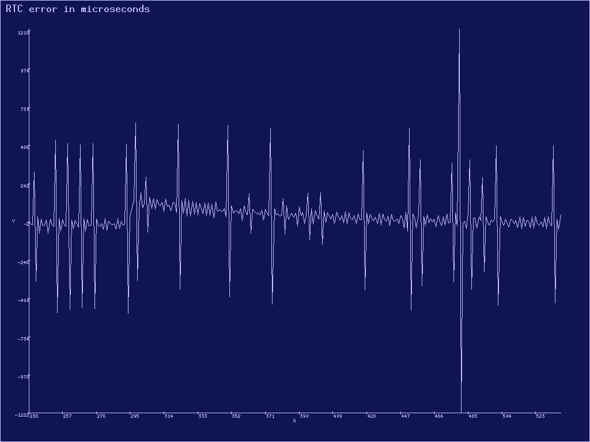
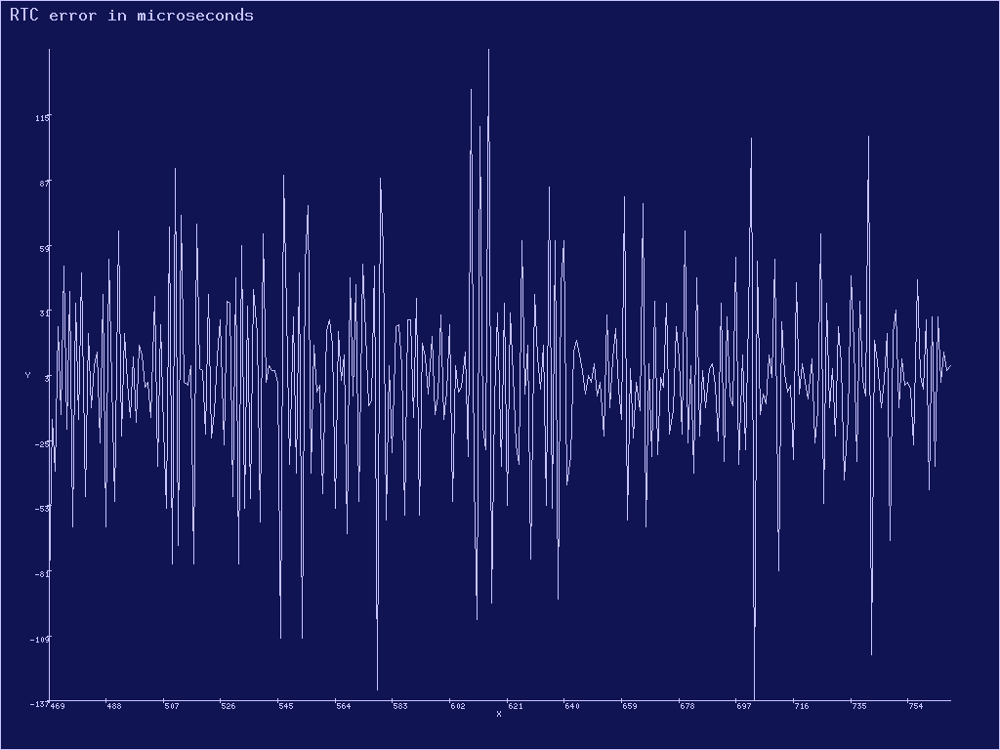

### Аллокатор больших блоков памяти


### Типажи [`core::alloc::Allocator`](https://doc.rust-lang.org/nightly/core/alloc/trait.Allocator.html) и [`ku::allocator::dry::DryAllocator`](../../doc/ku/allocator/dry/trait.DryAllocator.html)

Прежде всего, изучите Rust'овский интерфейс аллокатора памяти общего назначения --- типаж
[`core::alloc::Allocator`](https://doc.rust-lang.org/nightly/core/alloc/trait.Allocator.html).
Убедитесь, что вы понимаете:

- что такое [`core::alloc::Layout`](https://doc.rust-lang.org/nightly/core/alloc/struct.Layout.html);
- что такое [`core::ptr::NonNull`](https://doc.rust-lang.org/nightly/core/ptr/struct.NonNull.html);
- чем отличаются `NonNull<u8>` и `NonNull<[u8]>`;
- что означают маркеры `unsafe` на самом типаже и на его методах.

Также изучите типаж
[`ku::allocator::dry::DryAllocator`](../../doc/ku/allocator/dry/trait.DryAllocator.html).
Он очень похож на
[`core::alloc::Allocator`](https://doc.rust-lang.org/nightly/core/alloc/trait.Allocator.html),
и отличается только тем, что:

- Вместо двух методов [`core::alloc::Allocator::allocate()`](https://doc.rust-lang.org/nightly/core/alloc/trait.Allocator.html#tymethod.allocate) и [`core::alloc::Allocator::allocate_zeroed()`](https://doc.rust-lang.org/nightly/core/alloc/trait.Allocator.html#method.allocate_zeroed) имеет только один метод [`ku::allocator::dry::DryAllocator::dry_allocate()`](../../doc/ku/allocator/dry/trait.DryAllocator.html#tymethod.dry_allocate), принимающий признак необходимости занулить память [`ku::allocator::dry::Initialize`](../../doc/ku/allocator/dry/enum.Initialize.html). Это сделано, чтобы не дублировать код.
- Аналогично, вместо двух методов [`core::alloc::Allocator::grow()`](https://doc.rust-lang.org/nightly/core/alloc/trait.Allocator.html#method.grow) и [`core::alloc::Allocator::grow_zeroed()`](https://doc.rust-lang.org/nightly/core/alloc/trait.Allocator.html#method.grow_zeroed) он имеет только один метод [`ku::allocator::dry::DryAllocator::dry_grow()`](../../doc/ku/allocator/dry/trait.DryAllocator.html#tymethod.dry_grow).


### Типаж [`core::alloc::GlobalAlloc`](https://doc.rust-lang.org/nightly/core/alloc/trait.GlobalAlloc.html)

Типаж глобального аллокатора
[`core::alloc::GlobalAlloc`](https://doc.rust-lang.org/nightly/core/alloc/trait.GlobalAlloc.html)
немного отличается от
[`core::alloc::Allocator`](https://doc.rust-lang.org/nightly/core/alloc/trait.Allocator.html).
Изучите и его, он понадобится для общего понимания и в
[не обязательной задаче](../../lab/book/3-allocator-5-small.html#%D0%97%D0%B0%D0%B4%D0%B0%D1%87%D0%B0-2--%D0%B0%D0%BB%D0%BB%D0%BE%D0%BA%D0%B0%D1%82%D0%BE%D1%80-%D0%BC%D0%B0%D0%BB%D0%B5%D0%BD%D1%8C%D0%BA%D0%B8%D1%85-%D0%B1%D0%BB%D0%BE%D0%BA%D0%BE%D0%B2-%D0%BF%D0%B0%D0%BC%D1%8F%D1%82%D0%B8)
про аллокатор маленьких блоков памяти.


### Типаж [`ku::allocator::big::BigAllocator`](../../doc/ku/allocator/big/trait.BigAllocator.html)

Мы не можем воспользоваться реализацией по умолчанию для методов
[`Allocator::grow()`](https://doc.rust-lang.org/nightly/core/alloc/trait.Allocator.html#method.grow),
[`Allocator::grow_zeroed()`](https://doc.rust-lang.org/nightly/core/alloc/trait.Allocator.html#method.grow_zeroed) и
[`Allocator::shrink()`](https://doc.rust-lang.org/nightly/core/alloc/trait.Allocator.html#method.shrink).
Нам придётся переопределять их поведение, потому что мы хотим сделать следующий трюк.
При изменениях размера ранее выделенного блока мы не будем копировать содержимое памяти.
А вместо этого поменяем отображение физических фреймов старого блока памяти, на место нового блока памяти.

Естественно, это пройдёт только для блоков памяти, которые выровнены на границы страниц.
Интерфейс выделения таких блоков памяти задаётся типажом
[`ku::allocator::big::BigAllocator`](../../doc/ku/allocator/big/trait.BigAllocator.html).


### План

План состоит в том, чтобы

- Для [`kernel::allocator::Big`](../../doc/kernel/allocator/big/struct.Big.html) реализовать типаж [`ku::allocator::big::BigAllocator`](../../doc/ku/allocator/big/trait.BigAllocator.html). Этот пункт уже частично сделан, остался один метод --- [`BigAllocator::copy_mapping()`](../../doc/ku/allocator/big/trait.BigAllocator.html#tymethod.copy_mapping).
- Для типажа [`ku::allocator::big::BigAllocator`](../../doc/ku/allocator/big/trait.BigAllocator.html) реализовать типаж [`ku::allocator::dry::DryAllocator`](../../doc/ku/allocator/dry/trait.DryAllocator.html).
- Определить тип [`kernel::allocator::memory_allocator::MemoryAllocator`](../../doc/kernel/allocator/memory_allocator/struct.MemoryAllocator.html) и реализовать для него типаж [`core::alloc::Allocator`](https://doc.rust-lang.org/nightly/core/alloc/trait.Allocator.html) через реализованный ранее [`ku::allocator::dry::DryAllocator`](../../doc/ku/allocator/dry/trait.DryAllocator.html). Этот пункт уже сделан в файле [`kernel/src/allocator/memory_allocator.rs`](https://gitlab.com/sergey-v-galtsev/nikka-public/-/blob/master/kernel/src/allocator/memory_allocator.rs).

После этого станет доступен глобальный аллокатор памяти общего назначения
[`kernel::allocator::GLOBAL_ALLOCATOR`](../../doc/kernel/allocator/static.GLOBAL_ALLOCATOR.html).
Он использует
[`kernel::allocator::memory_allocator::MemoryAllocator`](../../doc/kernel/allocator/memory_allocator/struct.MemoryAllocator.html)
поверх базового адресного пространства
[`kernel::memory::BASE_ADDRESS_SPACE`](../../doc/kernel/memory/static.BASE_ADDRESS_SPACE.html)
и определён в файле
[`kernel/src/allocator/mod.rs`](https://gitlab.com/sergey-v-galtsev/nikka-public/-/blob/master/kernel/src/allocator/mod.rs).


### Статистики аллокатора [`ku::allocator::info::Info`](../../doc/ku/allocator/info/struct.Info.html)

При отладке задач этой лабораторной работы вам может помочь запись и
анализ статистик про выполняемые аллокатором операции.
Тесты можно будет запустить в режиме проверки инвариантов этих статистик,
для этого нужно указать опцию `--features allocator-statistics`.
Эта часть не обязательная, но в одной из последующих задач --- `allocator-statistics` ---
вы сможете получить за сбор этих статистик баллы.
В промышленных аллокаторах также доступны статистики использования кучи приложением,
но эти статистики обычно семплируются и привязываются к трассировкам стека приложения.
Семплирование требуется, чтобы уменьшить объём собираемых данных,
так как выделение памяти очень частая операция.
А привязка к трассировкам стека нужна для понимания, в каком месте приложения оно
выделяет основные объёмы памяти.
Легко найти иллюстрированные примеры для популярных библиотек выделения памяти:
- [для tcmalloc](https://postbits.de/heap-profiling-with-tcmalloc.html),
- [для jemalloc](https://github.com/jemalloc/jemalloc/wiki/Use-Case%3A-Leak-Checking).

Статистика операций аллокатора доступна в виде структуры
[`ku::allocator::info::Info`](../../doc/ku/allocator/info/struct.Info.html).
Её поля означают следующее:
- [`Info::allocations`](../../doc/ku/allocator/info/struct.Info.html#structfield.allocations) --- количество запросов к аллокатору.
- [`Info::requested`](../../doc/ku/allocator/info/struct.Info.html#structfield.requested) --- сколько памяти в байтах было запрошено у аллокатора.
- [`Info::allocated`](../../doc/ku/allocator/info/struct.Info.html#structfield.allocated) --- сколько памяти в байтах было выделено аллокатором, включая потери на округления размеров выделяемых блоков памяти.
- [`Info::pages`](../../doc/ku/allocator/info/struct.Info.html#structfield.pages) --- количество виртуальных страниц, которые были выделены для удовлетворения запросов.

Каждый такой счётчик является структурой
[`ku::allocator::info::Counter`](../../doc/ku/allocator/info/struct.Counter.html),
содержащей положительную и отрицательную компоненту:

- [`Counter::positive`](../../doc/ku/allocator/info/struct.Counter.html#structfield.positive) --- сумма соответствующего параметра для выделений памяти.
- [`Counter::negative`](../../doc/ku/allocator/info/struct.Counter.html#structfield.negative) --- сумма соответствующего параметра для освобождений памяти.

Метод [`Counter::balance()`](../../doc/ku/allocator/info/struct.Counter.html#method.balance) возвращает разность
`Counter::positive - Counter::negative`.
То есть, например:

- `info.allocated.positive()` --- количество выделенных байт за всё время работы, включая освобождённые в дальнейшем.
- `info.pages.negative()` --- количество освобождённых страниц.
- `info.requested.balance()` --- количество байт, которые были запрошены у аллокатора, но ещё не освобождены.

От этих чисел хочется интерпретируемости и соответствия естественным инвариантам.
Если количество выделений больше чем количество освобождений, то естественно ожидать, что какая-то память ещё занята.
А в ситуации, когда ещё и на входе и выходе балансы должны быть нулевые, это означает утечку.
Если же освобождений больше чем выделений в ситуации когда и на входе и выходе балансы должны быть нулевые,
это наталкивает на мысли о наличии какой-то серьёзной ошибки.
В частности, перевыделение учитывается как одно освобождение полного старого блока плюс одно выделение полного
нового блока.
Не создавайте несколько освобождений по кусочку старого блока при вызовах `dry_shrink()` или
фиктивных выделений нулевого размера.
Это сломает естественные инварианты и интерпретируемость значений
[`ku::allocator::info::Info`](../../doc/ku/allocator/info/struct.Info.html),
а также не пройдёт тесты при указании опции `--features allocator-statistics`.

Поэтому обратите внимание, как в
[`ku::allocator::info::Info`](../../doc/ku/allocator/info/struct.Info.html)
отслеживаются выделения и освобождения, которые выполняет ваш код.

В сообщениях журнала эти счётчики будут печататься так:

```console
20:26:37 0 D info = { allocations: 9 - 8 = 1, requested: 284.000 KiB - 156.000 KiB = 128.000 KiB, allocated: 284.000 KiB - 156.000 KiB = 128.000 KiB, pages: 71 - 39 = 32, loss: 0 B = 0.000% }
```


### Задача 1 --- аллокатор больших блоков памяти

Реализуйте метод
[`copy_mapping()`](../../doc/kernel/allocator/big/struct.Big.html#method.copy_mapping)
типажа
[`ku::allocator::big::BigAllocator`](../../doc/ku/allocator/big/trait.BigAllocator.html)
для
[`kernel::allocator::Big`](../../doc/kernel/allocator/big/struct.Big.html)
в файле
[`kernel/src/allocator/big.rs`](https://gitlab.com/sergey-v-galtsev/nikka-public/-/blob/master/kernel/src/allocator/big.rs):

```rust
unsafe fn copy_mapping(
    &mut self,
    old_block: Block<Page>,
    new_block: Block<Page>,
    flags: Option<PageTableFlags>,
) -> Result<()>;
```

Он копирует отображение физических фреймов из `old_block` в `new_block`.
Если изначально `new_block` содержал отображённые страницы,
их отображение удаляется.
Физические фреймы, на которые не осталось других ссылок, освобождаются.
После работы `copy_mapping()` содержимое памяти, которое ранее было доступно через `old_block`,
становится доступным ещё и через `new_block`.
Параметр `flags` задаёт флаги доступа к страницам `new_block`:
- `None` --- использовать те же флаги, что и в `old_block`, индивидуально для каждой страницы.
- `Some` --- использовать для всех страниц флаги `flags`.

Если `old_block` и `new_block` имеют разный размер или пересекаются,
за исключением случая совпадения при `flags == Some(...)`,
метод `copy_mapping()` возвращает ошибку
[`Error::InvalidArgument`](../../doc/ku/error/enum.Error.html#variant.InvalidArgument).
Если запрошенные флаги `flags` не допускаются этим аллокатором, метод возвращает ошибку
[`Error::PermissionDenied`](../../doc/ku/error/enum.Error.html#variant.PermissionDenied).

Когда выходной блок совпадает со входным и `flags == Some(...)`,
нужно поменять флаги отображения блока, не меняя целевые фреймы отображения.
Этот случай нам ещё понадобится при загрузке ELF--файла процесса в следующей лабораторной работе.

Реализуйте методы типажа
[`ku::allocator::dry::DryAllocator`](../../doc/ku/allocator/dry/trait.DryAllocator.html)
для типа, который уже реализует типаж
[`ku::allocator::big::BigAllocator`](../../doc/ku/allocator/big/trait.BigAllocator.html)
в файле
[`ku/src/allocator/big.rs`](https://gitlab.com/sergey-v-galtsev/nikka-public/-/blob/master/ku/src/allocator/big.rs).
При этом с виртуальным адресным пространством работайте через
[`ku::allocator::big::BigAllocator::reserve()`](../../doc/ku/allocator/big/trait.BigAllocator.html#tymethod.reserve),
[`ku::allocator::big::BigAllocator::unreserve()`](../../doc/ku/allocator/big/trait.BigAllocator.html#tymethod.unreserve) и
[`ku::allocator::big::BigAllocator::rereserve()`](../../doc/ku/allocator/big/trait.BigAllocator.html#tymethod.unreserve).
А чтобы менять его отображение на физическую память, используете
[`ku::allocator::big::BigAllocator::map()`](../../doc/ku/allocator/big/trait.BigAllocator.html#tymethod.map),
[`ku::allocator::big::BigAllocator::unmap()`](../../doc/ku/allocator/big/trait.BigAllocator.html#tymethod.unmap)
и
[`ku::allocator::big::BigAllocator::copy_mapping()`](../../doc/ku/allocator/big/trait.BigAllocator.html#tymethod.copy_mapping).
Естественно, все выдаваемые блоки памяти будут выровнены на границы страниц и по адресу и по размеру.

Вам могут пригодиться методы [`ku::memory::block::Block`](../../doc/ku/memory/block/struct.Block.html), например:

- [`Block::count()`](../../doc/ku/memory/block/struct.Block.html#method.count),
- [`Block::from_index()`](../../doc/ku/memory/block/struct.Block.html#method.from_index),
- [`Block::is_disjoint()`](../../doc/ku/memory/block/struct.Block.html#method.is_disjoint),
- [`Block::tail()`](../../doc/ku/memory/block/struct.Block.html#method.tail),
- [`Block::try_into_non_null_slice()`](../../doc/ku/memory/block/struct.Block.html#method.try_into_non_null_slice).

А также вспомогательные функции, определённые в том же файле
[`ku/src/allocator/big.rs`](https://gitlab.com/sergey-v-galtsev/nikka-public/-/blob/master/ku/src/allocator/big.rs):

- [`ku::allocator::big::try_into_block()`](../../doc/ku/allocator/big/fn.try_into_block.html)
- [`ku::allocator::big::initialize_block()`](../../doc/ku/allocator/big/fn.initialize_block.html).

В зависимости от вашей реализации `dry_shrink()`, вам может пригодиться или не пригодиться метод
[`BigAllocator::rereserve()`](../../doc/ku/allocator/big/trait.BigAllocator.html#tymethod.unreserve).

При реализации учтите, что даже если `old_layout` и `new_layout` в `dry_grow()` и `dry_shrink()` отличаются,
но при этом не отличаются соответствующие им блоки страниц `Block<Page>`,
то ничего делать не нужно.
Можно вернуть на выход срез со старым адресом, приведённый к новому размеру.


### Проверьте себя

Запустите тест `3-allocator-1-big` из файла
[`kernel/tests/3-allocator-1-big.rs`](https://gitlab.com/sergey-v-galtsev/nikka-public/-/blob/master/kernel/tests/3-allocator-1-big.rs).
Если вы поддерживаете статистики аллокатора, укажите флаг `--features allocator-statistics`,
иначе не указывайте его.
С этим флагом тесты проверяют инварианты статистик и помогут найти ошибки в аллокаторе.
Но будут падать, если сами статистики реализованы не верно или не так, как предполагают тесты.

```console
$ (cd kernel; cargo test --features allocator-statistics --test 3-allocator-1-big)
   Compiling ku v0.5.0 (/.../nikka/ku)
   Compiling kernel v0.5.0 (/.../nikka/kernel)
   Compiling text v0.5.0 (/.../nikka/text)
   Compiling pci v0.5.0 (/.../nikka/pci)
    Finished `test` profile [unoptimized + debuginfo] target(s) in 6.51s
     Running tests/3-allocator-1-big.rs (/.../nikka/target/kernel/debug/deps/3_allocator_1_big-e88094f68c262fe6)
Building bootloader
   Compiling bootloader v0.9.33 (/.../.cargo/registry/src/index.crates.io-1949cf8c6b5b557f/bootloader-0.9.33)
    Finished `release` profile [optimized + debuginfo] target(s) in 0.89s
Running: `qemu-system-x86_64 -drive format=raw,file=/.../nikka/target/kernel/debug/deps/bootimage-3_allocator_1_big-e88094f68c262fe6.bin -no-reboot -m size=128M -smp cpus=4 -device isa-debug-exit,iobase=0xF4,iosize=0x04 -serial stdio -display none -drive file=../fs.img,index=1,media=disk,driver=raw`
19:17:31 0 I RTC init; acknowledged_settings = RegisterB(USE_24_HOUR_FORMAT | UPDATE_ENDED_INTERRUPT)
19:17:31 0 I time init
19:17:31 0 I Nikka booted; now = 2025-11-02 19:17:31 UTC; tsc = Tsc(7246960859)
19:17:31 0 I GDT init
19:17:31 0 I traps init
19:17:31 0 D physical memory:
19:17:31 0 D     [0p0, 0p1000), size 4.000 KiB; type = FrameZero; usable = false; isolated = false
19:17:31 0 D     [0p1000, 0p5000), size 16.000 KiB; type = PageTable; usable = false; isolated = false
19:17:31 0 D     [0p5000, 0p1_6000), size 68.000 KiB; type = Bootloader; usable = false; isolated = false
19:17:31 0 D     [0p1_6000, 0p1_7000), size 4.000 KiB; type = BootInfo; usable = false; isolated = false
19:17:31 0 D     [0p1_7000, 0p1_E000), size 28.000 KiB; type = Kernel; usable = false; isolated = false
19:17:31 0 D     [0p1_E000, 0p9_F000), size 516.000 KiB; type = KernelStack; usable = false; isolated = false
19:17:31 0 D     [0p9_F000, 0pA_0000), size 4.000 KiB; type = Reserved; usable = false; isolated = false
19:17:31 0 D     [0pF_0000, 0p10_0000), size 64.000 KiB; type = Reserved; usable = false; isolated = true
19:17:31 0 D     [0p10_0000, 0p27_F000), size 1.496 MiB; type = KernelStack; usable = false; isolated = false
19:17:31 0 D     [0p27_F000, 0p40_0000), size 1.504 MiB; type = Usable; usable = true; isolated = false
19:17:31 0 D     [0p40_0000, 0p8D_8000), size 4.844 MiB; type = Kernel; usable = false; isolated = false
19:17:31 0 D     [0p8D_8000, 0p8E_2000), size 40.000 KiB; type = PageTable; usable = false; isolated = false
19:17:31 0 D     [0p8E_2000, 0p7FE_0000), size 118.992 MiB; type = Usable; usable = true; isolated = false
19:17:31 0 D     [0p7FE_0000, 0p800_0000), size 128.000 KiB; type = Reserved; usable = false; isolated = false
19:17:31 0 D     [0pFFFC_0000, 0p1_0000_0000), size 256.000 KiB; type = Reserved; usable = false; isolated = true
19:17:31 0 I physical_memory = [0p0, 0p800_0000), size 128.000 MiB; total = 128.000 MiB; usable = 127.625 MiB; total_frame_count = 32768; usable_total_frame_count = 32672
19:17:31 0 D frame allocator temporary storage; frame_count = 16384; physical_memory = 64.000 MiB
19:17:31 0 I frame allocator temporary storage init; free_frame_count = 14495; duration = 19.090 ms
19:17:31 0 I phys2virt = [0vFFFF_8000_0000_0000, 0vFFFF_8000_0800_0000), size 128.000 MiB -> [0p0, 0p800_0000), size 128.000 MiB; uses 4.000 KiB for the mapping itself
19:17:31 0 D remove recursive mapping; pte = 1 @ 0p1000 -----DA---WXP(0x63)
19:17:31 0 I page allocator init; free_page_count = 30064771071; block = [0v1000_0000_0000, 0v7FFF_FFFF_F000), size 112.000 TiB
19:17:31 0 I init; address_space = "base" @ 0p1000
19:17:31 0 I page allocator init; free_page_count = 3758096383; block = [0v180_0000_0000, 0vF7F_FFFF_F000), size 14.000 TiB
19:17:31 0 I drop; address_space = "base" @ 0p0
19:17:31 0 D frame allocator final storage mapped; duration = 74.626 ms
19:17:31 0 D frame allocator info copied from temporary storage; duration = 121.739 ms
19:17:31 0 D frame allocator final storage init; frame_count = 32768; physical_memory = 128.000 MiB; duration = 19.226 ms
19:17:31 0 I memory init; duration = 456.042 ms
19:17:31 0 D physical memory:
19:17:31 0 D     [0p0, 0p1000), size 4.000 KiB; type = FrameZero; usable = false; isolated = false
19:17:31 0 D     [0p1000, 0p5000), size 16.000 KiB; type = PageTable; usable = false; isolated = false
19:17:31 0 D     [0p5000, 0p1_6000), size 68.000 KiB; type = Bootloader; usable = false; isolated = false
19:17:31 0 D     [0p1_6000, 0p1_7000), size 4.000 KiB; type = BootInfo; usable = false; isolated = false
19:17:31 0 D     [0p1_7000, 0p1_E000), size 28.000 KiB; type = Kernel; usable = false; isolated = false
19:17:31 0 D     [0p1_E000, 0p9_F000), size 516.000 KiB; type = KernelStack; usable = false; isolated = false
19:17:31 0 D     [0p9_F000, 0pA_0000), size 4.000 KiB; type = Reserved; usable = false; isolated = false
19:17:31 0 D     [0pF_0000, 0p10_0000), size 64.000 KiB; type = Reserved; usable = false; isolated = true
19:17:31 0 D     [0p10_0000, 0p27_F000), size 1.496 MiB; type = KernelStack; usable = false; isolated = false
19:17:31 0 D     [0p27_F000, 0p40_0000), size 1.504 MiB; type = Usable; usable = true; isolated = false
19:17:31 0 D     [0p40_0000, 0p8D_8000), size 4.844 MiB; type = Kernel; usable = false; isolated = false
19:17:31 0 D     [0p8D_8000, 0p8E_2000), size 40.000 KiB; type = PageTable; usable = false; isolated = false
19:17:31 0 D     [0p8E_2000, 0p7FE_0000), size 118.992 MiB; type = Usable; usable = true; isolated = false
19:17:31 0 D     [0p7FE_0000, 0p800_0000), size 128.000 KiB; type = Reserved; usable = false; isolated = false
19:17:31 0 D     [0pFFFC_0000, 0p1_0000_0000), size 256.000 KiB; type = Reserved; usable = false; isolated = true
19:17:31 0 I physical_memory = [0p0, 0p800_0000), size 128.000 MiB; total = 128.000 MiB; usable = 127.625 MiB; total_frame_count = 32768; usable_total_frame_count = 32672
running 10 tests

3_allocator_1_big::alignment--------------------------------
19:17:31 0 D align = 1
19:17:32 0 D align = 2
19:17:32 0 D align = 4
19:17:32 0 D align = 8
19:17:32 0 D align = 16
19:17:33.051 0 D align = 32
19:17:33.275 0 D align = 64
19:17:33.503 0 D align = 128
19:17:33.725 0 D align = 256
19:17:33.953 0 D align = 512
19:17:34.175 0 D align = 1024
19:17:34.403 0 D align = 2048
19:17:34.633 0 D align = 4096
3_allocator_1_big::alignment----------------------- [passed]

3_allocator_1_big::basic------------------------------------
19:17:34.869 0 D start_info = { allocations: 2340 - 2340 = 0, requested: 8.110 MiB - 8.110 MiB = 0 B, allocated: 14.727 MiB - 14.727 MiB = 0 B, pages: 3770 - 3770 = 0, loss: 0 B = 0.000% }
19:17:34.891 0 D box_contents = 2
19:17:34.895 0 D info = { allocations: 2341 - 2340 = 1, requested: 8.110 MiB - 8.110 MiB = 8 B, allocated: 14.730 MiB - 14.727 MiB = 4.000 KiB, pages: 3771 - 3770 = 1, loss: 3.992 KiB = 99.805% }
19:17:34.915 0 D info_diff = { allocations: 1 - 0 = 1, requested: 8 B - 0 B = 8 B, allocated: 4.000 KiB - 0 B = 4.000 KiB, pages: 1 - 0 = 1, loss: 3.992 KiB = 99.805% }
19:17:34.933 0 D end_info = { allocations: 2341 - 2341 = 0, requested: 8.110 MiB - 8.110 MiB = 0 B, allocated: 14.730 MiB - 14.730 MiB = 0 B, pages: 3771 - 3771 = 0, loss: 0 B = 0.000% }
19:17:34.951 0 D end_info_diff = { allocations: 1 - 1 = 0, requested: 8 B - 8 B = 0 B, allocated: 4.000 KiB - 4.000 KiB = 0 B, pages: 1 - 1 = 0, loss: 0 B = 0.000% }
3_allocator_1_big::basic--------------------------- [passed]

3_allocator_1_big::copy_mapping_corner_cases----------------
19:17:35.003 0 D different intersecting blocks of the same size, no flags; expected_result = Err(InvalidArgument); old_block = [0v1000_0000_5000, 0v1000_0000_A000), size 20.000 KiB; new_block = [0v1000_0000_8000, 0v1000_0000_D000), size 20.000 KiB; flags = None
19:17:35.025 0 D different intersecting blocks of the same size, allowed flags; expected_result = Err(InvalidArgument); old_block = [0v1000_0000_5000, 0v1000_0000_A000), size 20.000 KiB; new_block = [0v1000_0000_8000, 0v1000_0000_D000), size 20.000 KiB; flags = Some(0x8000000000000005)
19:17:35.045 0 D different intersecting blocks of the same size, disallowed flags; expected_result = Err(InvalidArgument); old_block = [0v1000_0000_5000, 0v1000_0000_A000), size 20.000 KiB; new_block = [0v1000_0000_8000, 0v1000_0000_D000), size 20.000 KiB; flags = Some(0x8000000000000003)
19:17:35.065 0 D block size differs, no flags; expected_result = Err(InvalidArgument); old_block = [0v1000_0000_5000, 0v1000_0000_A000), size 20.000 KiB; new_block = [0v1000_0000_0000, 0v1000_0000_1000), size 4.000 KiB; flags = None
19:17:35.081 0 D block size differs, allowed flags; expected_result = Err(InvalidArgument); old_block = [0v1000_0000_5000, 0v1000_0000_A000), size 20.000 KiB; new_block = [0v1000_0000_0000, 0v1000_0000_1000), size 4.000 KiB; flags = Some(0x8000000000000005)
19:17:35.101 0 D block size differs, disallowed flags; expected_result = Err(InvalidArgument); old_block = [0v1000_0000_5000, 0v1000_0000_A000), size 20.000 KiB; new_block = [0v1000_0000_0000, 0v1000_0000_1000), size 4.000 KiB; flags = Some(0x8000000000000003)
19:17:35.121 0 D old block is a strict superblock, no flags; expected_result = Err(InvalidArgument); old_block = [0v1000_0000_5000, 0v1000_0000_A000), size 20.000 KiB; new_block = [0v1000_0000_6000, 0v1000_0000_7000), size 4.000 KiB; flags = None
19:17:35.141 0 D old block is a strict superblock, allowed flags; expected_result = Err(InvalidArgument); old_block = [0v1000_0000_5000, 0v1000_0000_A000), size 20.000 KiB; new_block = [0v1000_0000_6000, 0v1000_0000_7000), size 4.000 KiB; flags = Some(0x8000000000000005)
19:17:35.161 0 D old block is a strict superblock, disallowed flags; expected_result = Err(InvalidArgument); old_block = [0v1000_0000_5000, 0v1000_0000_A000), size 20.000 KiB; new_block = [0v1000_0000_6000, 0v1000_0000_7000), size 4.000 KiB; flags = Some(0x8000000000000003)
19:17:35.181 0 D block size differs, no flags; expected_result = Err(InvalidArgument); old_block = [0v1000_0000_0000, 0v1000_0000_1000), size 4.000 KiB; new_block = [0v1000_0000_5000, 0v1000_0000_A000), size 20.000 KiB; flags = None
19:17:35.199 0 D block size differs, allowed flags; expected_result = Err(InvalidArgument); old_block = [0v1000_0000_0000, 0v1000_0000_1000), size 4.000 KiB; new_block = [0v1000_0000_5000, 0v1000_0000_A000), size 20.000 KiB; flags = Some(0x8000000000000005)
19:17:35.219 0 D block size differs, disallowed flags; expected_result = Err(InvalidArgument); old_block = [0v1000_0000_0000, 0v1000_0000_1000), size 4.000 KiB; new_block = [0v1000_0000_5000, 0v1000_0000_A000), size 20.000 KiB; flags = Some(0x8000000000000003)
19:17:35.239 0 D new block is a strict superblock, no flags; expected_result = Err(InvalidArgument); old_block = [0v1000_0000_6000, 0v1000_0000_7000), size 4.000 KiB; new_block = [0v1000_0000_5000, 0v1000_0000_A000), size 20.000 KiB; flags = None
19:17:35.257 0 D new block is a strict superblock, allowed flags; expected_result = Err(InvalidArgument); old_block = [0v1000_0000_6000, 0v1000_0000_7000), size 4.000 KiB; new_block = [0v1000_0000_5000, 0v1000_0000_A000), size 20.000 KiB; flags = Some(0x8000000000000005)
19:17:35.279 0 D new block is a strict superblock, disallowed flags; expected_result = Err(InvalidArgument); old_block = [0v1000_0000_6000, 0v1000_0000_7000), size 4.000 KiB; new_block = [0v1000_0000_5000, 0v1000_0000_A000), size 20.000 KiB; flags = Some(0x8000000000000003)
19:17:35.299 0 D the same block, no flags; expected_result = Err(InvalidArgument); old_block = [0v1000_0000_0000, 0v1000_0000_1000), size 4.000 KiB; new_block = [0v1000_0000_0000, 0v1000_0000_1000), size 4.000 KiB; flags = None
19:17:35.315 0 D the same block, allowed flags; expected_result = Ok(()); old_block = [0v1000_0000_0000, 0v1000_0000_1000), size 4.000 KiB; new_block = [0v1000_0000_0000, 0v1000_0000_1000), size 4.000 KiB; flags = Some(0x8000000000000005)
19:17:35.335 0 D the same block, disallowed flags; expected_result = Err(PermissionDenied); old_block = [0v1000_0000_0000, 0v1000_0000_1000), size 4.000 KiB; new_block = [0v1000_0000_0000, 0v1000_0000_1000), size 4.000 KiB; flags = Some(0x8000000000000003)
19:17:35.357 0 D disjoint blocks of the same size, no flags; expected_result = Ok(()); old_block = [0v1000_0000_0000, 0v1000_0000_1000), size 4.000 KiB; new_block = [0v1000_0000_6000, 0v1000_0000_7000), size 4.000 KiB; flags = None
19:17:35.375 0 D disjoint blocks of the same size, allowed flags; expected_result = Ok(()); old_block = [0v1000_0000_0000, 0v1000_0000_1000), size 4.000 KiB; new_block = [0v1000_0000_6000, 0v1000_0000_7000), size 4.000 KiB; flags = Some(0x8000000000000005)
19:17:35.395 0 D disjoint blocks of the same size, disallowed flags; expected_result = Err(PermissionDenied); old_block = [0v1000_0000_0000, 0v1000_0000_1000), size 4.000 KiB; new_block = [0v1000_0000_6000, 0v1000_0000_7000), size 4.000 KiB; flags = Some(0x8000000000000003)
3_allocator_1_big::copy_mapping_corner_cases------- [passed]

3_allocator_1_big::copy_mapping_frame_references------------
19:17:35.425 0 D block = [0v7FFF_FFFF_C000, 0v7FFF_FFFF_F000), size 12.000 KiB; should_be_mapped = false
19:17:35.437 0 D page = 34359738364 @ 0v7FFF_FFFF_C000; translate_result = Err(NoPage)
19:17:35.445 0 D page = 34359738365 @ 0v7FFF_FFFF_D000; translate_result = Err(NoPage)
19:17:35.453 0 D page = 34359738366 @ 0v7FFF_FFFF_E000; translate_result = Err(NoPage)
19:17:35.461 0 D block = [0v7FFF_FFFF_9000, 0v7FFF_FFFF_C000), size 12.000 KiB; should_be_mapped = false
19:17:35.471 0 D page = 34359738361 @ 0v7FFF_FFFF_9000; translate_result = Err(NoPage)
19:17:35.479 0 D page = 34359738362 @ 0v7FFF_FFFF_A000; translate_result = Err(NoPage)
19:17:35.487 0 D page = 34359738363 @ 0v7FFF_FFFF_B000; translate_result = Err(NoPage)
19:17:35.513 0 D block = [0v7FFF_FFFF_C000, 0v7FFF_FFFF_F000), size 12.000 KiB; should_be_mapped = true
19:17:35.523 0 D page = 34359738364 @ 0v7FFF_FFFF_C000; pte = 1353 @ 0p54_9000 ---------UW-P(0x8000000000000007)
19:17:35.533 0 D page = 34359738365 @ 0v7FFF_FFFF_D000; pte = 1344 @ 0p54_0000 ---------UW-P(0x8000000000000007)
19:17:35.541 0 D page = 34359738366 @ 0v7FFF_FFFF_E000; pte = 1343 @ 0p53_F000 ---------UW-P(0x8000000000000007)
19:17:35.551 0 D block = [0v7FFF_FFFF_9000, 0v7FFF_FFFF_C000), size 12.000 KiB; should_be_mapped = false
19:17:35.561 0 D page = 34359738361 @ 0v7FFF_FFFF_9000; pte = <non-present>
19:17:35.565 0 D page = 34359738362 @ 0v7FFF_FFFF_A000; pte = <non-present>
19:17:35.571 0 D page = 34359738363 @ 0v7FFF_FFFF_B000; pte = <non-present>
19:17:35.575 0 D block = [0v7FFF_FFFF_C000, 0v7FFF_FFFF_F000), size 12.000 KiB; expected_reference_count = 1
19:17:35.587 0 D page = 34359738364 @ 0v7FFF_FFFF_C000; pte = 1353 @ 0p54_9000 ---------UW-P(0x8000000000000007); reference_count = 1
19:17:35.597 0 D page = 34359738365 @ 0v7FFF_FFFF_D000; pte = 1344 @ 0p54_0000 ---------UW-P(0x8000000000000007); reference_count = 1
19:17:35.607 0 D page = 34359738366 @ 0v7FFF_FFFF_E000; pte = 1343 @ 0p53_F000 ---------UW-P(0x8000000000000007); reference_count = 1
19:17:35.617 0 D block = [0v7FFF_FFFF_C000, 0v7FFF_FFFF_F000), size 12.000 KiB; should_be_mapped = true
19:17:35.629 0 D page = 34359738364 @ 0v7FFF_FFFF_C000; pte = 1353 @ 0p54_9000 ---------UW-P(0x8000000000000007)
19:17:35.637 0 D page = 34359738365 @ 0v7FFF_FFFF_D000; pte = 1344 @ 0p54_0000 ---------UW-P(0x8000000000000007)
19:17:35.647 0 D page = 34359738366 @ 0v7FFF_FFFF_E000; pte = 1343 @ 0p53_F000 ---------UW-P(0x8000000000000007)
19:17:35.655 0 D blocks should be equal; a = [0v7FFF_FFFF_C000, 0v7FFF_FFFF_F000), size 12.000 KiB; b = [0v7FFF_FFFF_9000, 0v7FFF_FFFF_C000), size 12.000 KiB
19:17:35.669 0 D a_pte = Ok(1353 @ 0p54_9000 ---------UW-P(0x8000000000000007)); b_pte = Ok(1353 @ 0p54_9000 ---------UW-P(0x8000000000000007))
19:17:35.681 0 D a_pte = Ok(1344 @ 0p54_0000 ---------UW-P(0x8000000000000007)); b_pte = Ok(1344 @ 0p54_0000 ---------UW-P(0x8000000000000007))
19:17:35.691 0 D a_pte = Ok(1343 @ 0p53_F000 ---------UW-P(0x8000000000000007)); b_pte = Ok(1343 @ 0p53_F000 ---------UW-P(0x8000000000000007))
19:17:35.701 0 D block = [0v7FFF_FFFF_C000, 0v7FFF_FFFF_F000), size 12.000 KiB; expected_reference_count = 2
19:17:35.711 0 D page = 34359738364 @ 0v7FFF_FFFF_C000; pte = 1353 @ 0p54_9000 ---------UW-P(0x8000000000000007); reference_count = 2
19:17:35.721 0 D page = 34359738365 @ 0v7FFF_FFFF_D000; pte = 1344 @ 0p54_0000 ---------UW-P(0x8000000000000007); reference_count = 2
19:17:35.731 0 D page = 34359738366 @ 0v7FFF_FFFF_E000; pte = 1343 @ 0p53_F000 ---------UW-P(0x8000000000000007); reference_count = 2
19:17:35.741 0 D block = [0v7FFF_FFFF_C000, 0v7FFF_FFFF_F000), size 12.000 KiB; should_be_mapped = false
19:17:35.751 0 D page = 34359738364 @ 0v7FFF_FFFF_C000; pte = <non-present>
19:17:35.757 0 D page = 34359738365 @ 0v7FFF_FFFF_D000; pte = <non-present>
19:17:35.761 0 D page = 34359738366 @ 0v7FFF_FFFF_E000; pte = <non-present>
19:17:35.767 0 D block = [0v7FFF_FFFF_9000, 0v7FFF_FFFF_C000), size 12.000 KiB; should_be_mapped = true
19:17:35.777 0 D page = 34359738361 @ 0v7FFF_FFFF_9000; pte = 1353 @ 0p54_9000 ---------UW-P(0x8000000000000007)
19:17:35.787 0 D page = 34359738362 @ 0v7FFF_FFFF_A000; pte = 1344 @ 0p54_0000 ---------UW-P(0x8000000000000007)
19:17:35.795 0 D page = 34359738363 @ 0v7FFF_FFFF_B000; pte = 1343 @ 0p53_F000 ---------UW-P(0x8000000000000007)
19:17:35.805 0 D block = [0v7FFF_FFFF_9000, 0v7FFF_FFFF_C000), size 12.000 KiB; expected_reference_count = 1
19:17:35.815 0 D page = 34359738361 @ 0v7FFF_FFFF_9000; pte = 1353 @ 0p54_9000 ---------UW-P(0x8000000000000007); reference_count = 1
19:17:35.825 0 D page = 34359738362 @ 0v7FFF_FFFF_A000; pte = 1344 @ 0p54_0000 ---------UW-P(0x8000000000000007); reference_count = 1
19:17:35.835 0 D page = 34359738363 @ 0v7FFF_FFFF_B000; pte = 1343 @ 0p53_F000 ---------UW-P(0x8000000000000007); reference_count = 1
19:17:35.845 0 D block = [0v7FFF_FFFF_C000, 0v7FFF_FFFF_F000), size 12.000 KiB; should_be_mapped = false
19:17:35.855 0 D page = 34359738364 @ 0v7FFF_FFFF_C000; pte = <non-present>
19:17:35.861 0 D page = 34359738365 @ 0v7FFF_FFFF_D000; pte = <non-present>
19:17:35.865 0 D page = 34359738366 @ 0v7FFF_FFFF_E000; pte = <non-present>
19:17:35.871 0 D block = [0v7FFF_FFFF_9000, 0v7FFF_FFFF_C000), size 12.000 KiB; should_be_mapped = false
19:17:35.881 0 D page = 34359738361 @ 0v7FFF_FFFF_9000; pte = <non-present>
19:17:35.885 0 D page = 34359738362 @ 0v7FFF_FFFF_A000; pte = <non-present>
19:17:35.891 0 D page = 34359738363 @ 0v7FFF_FFFF_B000; pte = <non-present>
3_allocator_1_big::copy_mapping_frame_references--- [passed]

3_allocator_1_big::copy_mapping_same_block------------------
3_allocator_1_big::copy_mapping_same_block--------- [passed]

3_allocator_1_big::grow_and_shrink--------------------------
19:17:35.921 0 D start_info = { allocations: 2341 - 2341 = 0, requested: 8.110 MiB - 8.110 MiB = 0 B, allocated: 14.730 MiB - 14.730 MiB = 0 B, pages: 3771 - 3771 = 0, loss: 0 B = 0.000% }
19:17:36.005 0 D contents_sum = 75491328; push_sum = 75491328
19:17:36.011 0 D info = { allocations: 2354 - 2353 = 1, requested: 8.360 MiB - 8.235 MiB = 128.000 KiB, allocated: 15.004 MiB - 14.879 MiB = 128.000 KiB, pages: 3841 - 3809 = 32, loss: 0 B = 0.000% }
19:17:36.029 0 D info_diff = { allocations: 13 - 12 = 1, requested: 255.969 KiB - 127.969 KiB = 128.000 KiB, allocated: 280.000 KiB - 152.000 KiB = 128.000 KiB, pages: 70 - 38 = 32, loss: 0 B = 0.000% }
19:17:36.079 0 D contents_sum = 75491328; pop_sum = 75491328
19:17:36.083 0 D end_info = { allocations: 2368 - 2368 = 0, requested: 8.485 MiB - 8.485 MiB = 0 B, allocated: 15.160 MiB - 15.160 MiB = 0 B, pages: 3881 - 3881 = 0, loss: 0 B = 0.000% }
19:17:36.097 0 D end_info_diff = { allocations: 27 - 27 = 0, requested: 383.961 KiB - 383.961 KiB = 0 B, allocated: 440.000 KiB - 440.000 KiB = 0 B, pages: 110 - 110 = 0, loss: 0 B = 0.000% }
3_allocator_1_big::grow_and_shrink----------------- [passed]

3_allocator_1_big::grow_and_shrink_unmap_old_block----------
19:17:36.123 0 D initialize = Garbage
19:17:36.137 0 D small_block = [0v7FFF_FFFF_2000, 0v7FFF_FFFF_6000), size 16.000 KiB; big_block = [0v7FFF_FFFE_A000, 0v7FFF_FFFF_2000), size 32.000 KiB
19:17:36.153 0 D unmapped_pages = 4
19:17:36.157 0 D big_block = [0v7FFF_FFFE_A000, 0v7FFF_FFFF_2000), size 32.000 KiB; medium_block = [0v7FFF_FFFE_A000, 0v7FFF_FFFF_0000), size 24.000 KiB
19:17:36.171 0 D unmapped_pages = 2
19:17:36.179 0 D initialize = Zero
19:17:36.197 0 D small_block = [0v7FFF_FFFE_6000, 0v7FFF_FFFE_A000), size 16.000 KiB; big_block = [0v7FFF_FFFD_E000, 0v7FFF_FFFE_6000), size 32.000 KiB
19:17:36.211 0 D unmapped_pages = 4
19:17:36.219 0 D big_block = [0v7FFF_FFFD_E000, 0v7FFF_FFFE_6000), size 32.000 KiB; medium_block = [0v7FFF_FFFD_E000, 0v7FFF_FFFE_4000), size 24.000 KiB
19:17:36.233 0 D unmapped_pages = 2
3_allocator_1_big::grow_and_shrink_unmap_old_block- [passed]

3_allocator_1_big::paged_realloc_is_cheap-------------------
19:17:36.255 0 D block = [0vF7F_FF08_4000, 0vF7F_FF08_5000), size 4.000 KiB; frames = [1342 @ 0p53_E000 ----------W-P(0x8000000000000003)]
19:17:36.273 0 D block = [0vF7F_FF08_1000, 0vF7F_FF08_3000), size 8.000 KiB; frames = [1342 @ 0p53_E000 ----------W-P(0x8000000000000003), 1339 @ 0p53_B000 ----------W-P(0x8000000000000003)]
19:17:36.297 0 D block = [0vF7F_FF07_C000, 0vF7F_FF08_0000), size 16.000 KiB; frames = [1342 @ 0p53_E000 ----------W-P(0x8000000000000003), 1339 @ 0p53_B000 ----------W-P(0x8000000000000003), 1341 @ 0p53_D000 ----------W-P(0x8000000000000003), 1335 @ 0p53_7000 ----------W-P(0x8000000000000003)]
19:17:36.337 0 D block = [0vF7F_FF07_3000, 0vF7F_FF07_B000), size 32.000 KiB; frames = [1342 @ 0p53_E000 ----------W-P(0x8000000000000003), 1339 @ 0p53_B000 ----------W-P(0x8000000000000003), 1341 @ 0p53_D000 ----------W-P(0x8000000000000003), 1335 @ 0p53_7000 ----------W-P(0x8000000000000003), 1340 @ 0p53_C000 ----------W-P(0x8000000000000003), 1337 @ 0p53_9000 ----------W-P(0x8000000000000003), 1338 @ 0p53_A000 ----------W-P(0x8000000000000003), 1327 @ 0p52_F000 ----------W-P(0x8000000000000003)]
19:17:36.405 0 D block = [0vF7F_FF06_2000, 0vF7F_FF07_2000), size 64.000 KiB; frames = [1342 @ 0p53_E000 ----------W-P(0x8000000000000003), 1339 @ 0p53_B000 ----------W-P(0x8000000000000003), 1341 @ 0p53_D000 ----------W-P(0x8000000000000003), 1335 @ 0p53_7000 ----------W-P(0x8000000000000003), 1340 @ 0p53_C000 ----------W-P(0x8000000000000003), 1337 @ 0p53_9000 ----------W-P(0x8000000000000003), 1338 @ 0p53_A000 ----------W-P(0x8000000000000003), 1327 @ 0p52_F000 ----------W-P(0x8000000000000003), 1336 @ 0p53_8000 ----------W-P(0x8000000000000003), 1329 @ 0p53_1000 ----------W-P(0x8000000000000003), 1330 @ 0p53_2000 ----------W-P(0x8000000000000003), 1331 @ 0p53_3000 ----------W-P(0x8000000000000003), 1332 @ 0p53_4000 ----------W-P(0x8000000000000003), 1333 @ 0p53_5000 ----------W-P(0x8000000000000003), 1334 @ 0p53_6000 ----------W-P(0x8000000000000003), 1311 @ 0p51_F000 ----------W-P(0x8000000000000003)]
19:17:36.477 0 D block = [0vF7F_FF06_2000, 0vF7F_FF07_1000), size 60.000 KiB; frames = [1342 @ 0p53_E000 ----------W-P(0x8000000000000003), 1339 @ 0p53_B000 ----------W-P(0x8000000000000003), 1341 @ 0p53_D000 ----------W-P(0x8000000000000003), 1335 @ 0p53_7000 ----------W-P(0x8000000000000003), 1340 @ 0p53_C000 ----------W-P(0x8000000000000003), 1337 @ 0p53_9000 ----------W-P(0x8000000000000003), 1338 @ 0p53_A000 ----------W-P(0x8000000000000003), 1327 @ 0p52_F000 ----------W-P(0x8000000000000003), 1336 @ 0p53_8000 ----------W-P(0x8000000000000003), 1329 @ 0p53_1000 ----------W-P(0x8000000000000003), 1330 @ 0p53_2000 ----------W-P(0x8000000000000003), 1331 @ 0p53_3000 ----------W-P(0x8000000000000003), 1332 @ 0p53_4000 ----------W-P(0x8000000000000003), 1333 @ 0p53_5000 ----------W-P(0x8000000000000003), 1334 @ 0p53_6000 ----------W-P(0x8000000000000003)]
19:17:36.545 0 D block = [0vF7F_FF06_2000, 0vF7F_FF07_0000), size 56.000 KiB; frames = [1342 @ 0p53_E000 ----------W-P(0x8000000000000003), 1339 @ 0p53_B000 ----------W-P(0x8000000000000003), 1341 @ 0p53_D000 ----------W-P(0x8000000000000003), 1335 @ 0p53_7000 ----------W-P(0x8000000000000003), 1340 @ 0p53_C000 ----------W-P(0x8000000000000003), 1337 @ 0p53_9000 ----------W-P(0x8000000000000003), 1338 @ 0p53_A000 ----------W-P(0x8000000000000003), 1327 @ 0p52_F000 ----------W-P(0x8000000000000003), 1336 @ 0p53_8000 ----------W-P(0x8000000000000003), 1329 @ 0p53_1000 ----------W-P(0x8000000000000003), 1330 @ 0p53_2000 ----------W-P(0x8000000000000003), 1331 @ 0p53_3000 ----------W-P(0x8000000000000003), 1332 @ 0p53_4000 ----------W-P(0x8000000000000003), 1333 @ 0p53_5000 ----------W-P(0x8000000000000003)]
19:17:36.611 0 D block = [0vF7F_FF06_2000, 0vF7F_FF06_F000), size 52.000 KiB; frames = [1342 @ 0p53_E000 ----------W-P(0x8000000000000003), 1339 @ 0p53_B000 ----------W-P(0x8000000000000003), 1341 @ 0p53_D000 ----------W-P(0x8000000000000003), 1335 @ 0p53_7000 ----------W-P(0x8000000000000003), 1340 @ 0p53_C000 ----------W-P(0x8000000000000003), 1337 @ 0p53_9000 ----------W-P(0x8000000000000003), 1338 @ 0p53_A000 ----------W-P(0x8000000000000003), 1327 @ 0p52_F000 ----------W-P(0x8000000000000003), 1336 @ 0p53_8000 ----------W-P(0x8000000000000003), 1329 @ 0p53_1000 ----------W-P(0x8000000000000003), 1330 @ 0p53_2000 ----------W-P(0x8000000000000003), 1331 @ 0p53_3000 ----------W-P(0x8000000000000003), 1332 @ 0p53_4000 ----------W-P(0x8000000000000003)]
19:17:36.673 0 D block = [0vF7F_FF06_2000, 0vF7F_FF06_E000), size 48.000 KiB; frames = [1342 @ 0p53_E000 ----------W-P(0x8000000000000003), 1339 @ 0p53_B000 ----------W-P(0x8000000000000003), 1341 @ 0p53_D000 ----------W-P(0x8000000000000003), 1335 @ 0p53_7000 ----------W-P(0x8000000000000003), 1340 @ 0p53_C000 ----------W-P(0x8000000000000003), 1337 @ 0p53_9000 ----------W-P(0x8000000000000003), 1338 @ 0p53_A000 ----------W-P(0x8000000000000003), 1327 @ 0p52_F000 ----------W-P(0x8000000000000003), 1336 @ 0p53_8000 ----------W-P(0x8000000000000003), 1329 @ 0p53_1000 ----------W-P(0x8000000000000003), 1330 @ 0p53_2000 ----------W-P(0x8000000000000003), 1331 @ 0p53_3000 ----------W-P(0x8000000000000003)]
19:17:36.729 0 D block = [0vF7F_FF06_2000, 0vF7F_FF06_D000), size 44.000 KiB; frames = [1342 @ 0p53_E000 ----------W-P(0x8000000000000003), 1339 @ 0p53_B000 ----------W-P(0x8000000000000003), 1341 @ 0p53_D000 ----------W-P(0x8000000000000003), 1335 @ 0p53_7000 ----------W-P(0x8000000000000003), 1340 @ 0p53_C000 ----------W-P(0x8000000000000003), 1337 @ 0p53_9000 ----------W-P(0x8000000000000003), 1338 @ 0p53_A000 ----------W-P(0x8000000000000003), 1327 @ 0p52_F000 ----------W-P(0x8000000000000003), 1336 @ 0p53_8000 ----------W-P(0x8000000000000003), 1329 @ 0p53_1000 ----------W-P(0x8000000000000003), 1330 @ 0p53_2000 ----------W-P(0x8000000000000003)]
19:17:36.785 0 D block = [0vF7F_FF06_2000, 0vF7F_FF06_C000), size 40.000 KiB; frames = [1342 @ 0p53_E000 ----------W-P(0x8000000000000003), 1339 @ 0p53_B000 ----------W-P(0x8000000000000003), 1341 @ 0p53_D000 ----------W-P(0x8000000000000003), 1335 @ 0p53_7000 ----------W-P(0x8000000000000003), 1340 @ 0p53_C000 ----------W-P(0x8000000000000003), 1337 @ 0p53_9000 ----------W-P(0x8000000000000003), 1338 @ 0p53_A000 ----------W-P(0x8000000000000003), 1327 @ 0p52_F000 ----------W-P(0x8000000000000003), 1336 @ 0p53_8000 ----------W-P(0x8000000000000003), 1329 @ 0p53_1000 ----------W-P(0x8000000000000003)]
19:17:36.835 0 D block = [0vF7F_FF06_2000, 0vF7F_FF06_B000), size 36.000 KiB; frames = [1342 @ 0p53_E000 ----------W-P(0x8000000000000003), 1339 @ 0p53_B000 ----------W-P(0x8000000000000003), 1341 @ 0p53_D000 ----------W-P(0x8000000000000003), 1335 @ 0p53_7000 ----------W-P(0x8000000000000003), 1340 @ 0p53_C000 ----------W-P(0x8000000000000003), 1337 @ 0p53_9000 ----------W-P(0x8000000000000003), 1338 @ 0p53_A000 ----------W-P(0x8000000000000003), 1327 @ 0p52_F000 ----------W-P(0x8000000000000003), 1336 @ 0p53_8000 ----------W-P(0x8000000000000003)]
19:17:36.883 0 D block = [0vF7F_FF06_2000, 0vF7F_FF06_A000), size 32.000 KiB; frames = [1342 @ 0p53_E000 ----------W-P(0x8000000000000003), 1339 @ 0p53_B000 ----------W-P(0x8000000000000003), 1341 @ 0p53_D000 ----------W-P(0x8000000000000003), 1335 @ 0p53_7000 ----------W-P(0x8000000000000003), 1340 @ 0p53_C000 ----------W-P(0x8000000000000003), 1337 @ 0p53_9000 ----------W-P(0x8000000000000003), 1338 @ 0p53_A000 ----------W-P(0x8000000000000003), 1327 @ 0p52_F000 ----------W-P(0x8000000000000003)]
19:17:36.927 0 D block = [0vF7F_FF06_2000, 0vF7F_FF06_9000), size 28.000 KiB; frames = [1342 @ 0p53_E000 ----------W-P(0x8000000000000003), 1339 @ 0p53_B000 ----------W-P(0x8000000000000003), 1341 @ 0p53_D000 ----------W-P(0x8000000000000003), 1335 @ 0p53_7000 ----------W-P(0x8000000000000003), 1340 @ 0p53_C000 ----------W-P(0x8000000000000003), 1337 @ 0p53_9000 ----------W-P(0x8000000000000003), 1338 @ 0p53_A000 ----------W-P(0x8000000000000003)]
19:17:36.967 0 D block = [0vF7F_FF06_2000, 0vF7F_FF06_8000), size 24.000 KiB; frames = [1342 @ 0p53_E000 ----------W-P(0x8000000000000003), 1339 @ 0p53_B000 ----------W-P(0x8000000000000003), 1341 @ 0p53_D000 ----------W-P(0x8000000000000003), 1335 @ 0p53_7000 ----------W-P(0x8000000000000003), 1340 @ 0p53_C000 ----------W-P(0x8000000000000003), 1337 @ 0p53_9000 ----------W-P(0x8000000000000003)]
19:17:37.003 0 D block = [0vF7F_FF06_2000, 0vF7F_FF06_7000), size 20.000 KiB; frames = [1342 @ 0p53_E000 ----------W-P(0x8000000000000003), 1339 @ 0p53_B000 ----------W-P(0x8000000000000003), 1341 @ 0p53_D000 ----------W-P(0x8000000000000003), 1335 @ 0p53_7000 ----------W-P(0x8000000000000003), 1340 @ 0p53_C000 ----------W-P(0x8000000000000003)]
19:17:37.037 0 D block = [0vF7F_FF06_2000, 0vF7F_FF06_6000), size 16.000 KiB; frames = [1342 @ 0p53_E000 ----------W-P(0x8000000000000003), 1339 @ 0p53_B000 ----------W-P(0x8000000000000003), 1341 @ 0p53_D000 ----------W-P(0x8000000000000003), 1335 @ 0p53_7000 ----------W-P(0x8000000000000003)]
19:17:37.067 0 D block = [0vF7F_FF06_2000, 0vF7F_FF06_5000), size 12.000 KiB; frames = [1342 @ 0p53_E000 ----------W-P(0x8000000000000003), 1339 @ 0p53_B000 ----------W-P(0x8000000000000003), 1341 @ 0p53_D000 ----------W-P(0x8000000000000003)]
19:17:37.097 0 D block = [0vF7F_FF06_2000, 0vF7F_FF06_4000), size 8.000 KiB; frames = [1342 @ 0p53_E000 ----------W-P(0x8000000000000003), 1339 @ 0p53_B000 ----------W-P(0x8000000000000003)]
19:17:37.121 0 D block = [0vF7F_FF06_2000, 0vF7F_FF06_3000), size 4.000 KiB; frames = [1342 @ 0p53_E000 ----------W-P(0x8000000000000003)]
19:17:37.139 0 D block = [0v1000, 0v1000), size 0 B; frames = []
3_allocator_1_big::paged_realloc_is_cheap---------- [passed]

3_allocator_1_big::shrink_is_not_a_noop---------------------
19:17:37.155 0 D initialize = Garbage
19:17:37.163 0 D old_block = [0v7FFF_FFFD_A000, 0v7FFF_FFFD_E000), size 16.000 KiB; new_block = [0v7FFF_FFFD_A000, 0v7FFF_FFFD_D000), size 12.000 KiB; no_remap_on_shrink = true
19:17:37.179 0 D initialize = Zero
19:17:37.189 0 D old_block = [0v7FFF_FFFD_6000, 0v7FFF_FFFD_A000), size 16.000 KiB; new_block = [0v7FFF_FFFD_6000, 0v7FFF_FFFD_9000), size 12.000 KiB; no_remap_on_shrink = true
3_allocator_1_big::shrink_is_not_a_noop------------ [passed]

3_allocator_1_big::stress-----------------------------------
19:17:37.217 0 D start_info = { allocations: 2408 - 2408 = 0, requested: 9.076 MiB - 9.076 MiB = 0 B, allocated: 15.828 MiB - 15.828 MiB = 0 B, pages: 4052 - 4052 = 0, loss: 0 B = 0.000% }
19:17:37.743 0 D vector_length = 500; fragmentation_loss = 2.254 MiB; max_fragmentation_loss = 16.000 MiB
19:17:38.269 0 D vector_length = 1000; fragmentation_loss = 4.518 MiB; max_fragmentation_loss = 16.000 MiB
19:17:38.789 0 D vector_length = 1500; fragmentation_loss = 6.772 MiB; max_fragmentation_loss = 16.000 MiB
19:17:39.333 0 D vector_length = 2000; fragmentation_loss = 9.036 MiB; max_fragmentation_loss = 16.000 MiB
19:17:39.859 0 D vector_length = 2500; fragmentation_loss = 11.290 MiB; max_fragmentation_loss = 19.531 MiB
19:17:40.379 0 D vector_length = 3000; fragmentation_loss = 13.544 MiB; max_fragmentation_loss = 23.438 MiB
19:17:40.905 0 D vector_length = 3500; fragmentation_loss = 15.805 MiB; max_fragmentation_loss = 27.344 MiB
19:17:41.425 0 D vector_length = 4000; fragmentation_loss = 18.058 MiB; max_fragmentation_loss = 31.250 MiB
19:17:41.967 0 D vector_length = 4500; fragmentation_loss = 20.330 MiB; max_fragmentation_loss = 35.156 MiB
19:17:42.487 0 D vector_length = 5000; fragmentation_loss = 22.584 MiB; max_fragmentation_loss = 39.062 MiB
19:17:43.015 0 D vector_length = 5500; fragmentation_loss = 24.845 MiB; max_fragmentation_loss = 42.969 MiB
19:17:43.537 0 D vector_length = 6000; fragmentation_loss = 27.098 MiB; max_fragmentation_loss = 46.875 MiB
19:17:44.063 0 D vector_length = 6500; fragmentation_loss = 29.355 MiB; max_fragmentation_loss = 50.781 MiB
19:17:44.589 0 D vector_length = 7000; fragmentation_loss = 31.620 MiB; max_fragmentation_loss = 54.688 MiB
19:17:45.117 0 D vector_length = 7500; fragmentation_loss = 33.877 MiB; max_fragmentation_loss = 58.594 MiB
19:17:45.647 0 D vector_length = 8000; fragmentation_loss = 36.135 MiB; max_fragmentation_loss = 62.500 MiB
19:17:46.197 0 D vector_length = 8500; fragmentation_loss = 38.388 MiB; max_fragmentation_loss = 66.406 MiB
19:17:46.719 0 D vector_length = 9000; fragmentation_loss = 40.649 MiB; max_fragmentation_loss = 70.312 MiB
19:17:47.249 0 D vector_length = 9500; fragmentation_loss = 42.910 MiB; max_fragmentation_loss = 74.219 MiB
19:17:47.773 0 D vector_length = 10000; fragmentation_loss = 45.167 MiB; max_fragmentation_loss = 78.125 MiB
19:17:47.791 0 D contents_sum = 333283335000; push_sum = 333283335000
19:17:47.797 0 D info = { allocations: 14087 - 2420 = 11667, requested: 9.729 MiB - 9.201 MiB = 540.812 KiB, allocated: 61.672 MiB - 15.977 MiB = 45.695 MiB, pages: 15788 - 4090 = 11698, loss: 45.167 MiB = 98.844% }
19:17:47.815 0 D info_diff = { allocations: 11679 - 12 = 11667, requested: 668.781 KiB - 127.969 KiB = 540.812 KiB, allocated: 45.844 MiB - 152.000 KiB = 45.695 MiB, pages: 11736 - 38 = 11698, loss: 45.167 MiB = 98.844% }
19:17:48.055 0 D vector_length = 9500; fragmentation_loss = 43.218 MiB; max_fragmentation_loss = 74.219 MiB
19:17:48.283 0 D vector_length = 9000; fragmentation_loss = 41.269 MiB; max_fragmentation_loss = 70.312 MiB
19:17:48.517 0 D vector_length = 8500; fragmentation_loss = 39.319 MiB; max_fragmentation_loss = 66.406 MiB
19:17:48.751 0 D vector_length = 8000; fragmentation_loss = 37.370 MiB; max_fragmentation_loss = 62.500 MiB
19:17:48.981 0 D vector_length = 7500; fragmentation_loss = 35.421 MiB; max_fragmentation_loss = 58.594 MiB
19:17:49.211 0 D vector_length = 7000; fragmentation_loss = 33.471 MiB; max_fragmentation_loss = 54.688 MiB
19:17:49.441 0 D vector_length = 6500; fragmentation_loss = 31.522 MiB; max_fragmentation_loss = 50.781 MiB
19:17:49.671 0 D vector_length = 6000; fragmentation_loss = 29.573 MiB; max_fragmentation_loss = 46.875 MiB
19:17:49.903 0 D vector_length = 5500; fragmentation_loss = 27.623 MiB; max_fragmentation_loss = 42.969 MiB
19:17:50.133 0 D vector_length = 5000; fragmentation_loss = 25.674 MiB; max_fragmentation_loss = 39.062 MiB
19:17:50.365 0 D vector_length = 4500; fragmentation_loss = 23.725 MiB; max_fragmentation_loss = 35.156 MiB
19:17:50.595 0 D vector_length = 4000; fragmentation_loss = 21.775 MiB; max_fragmentation_loss = 31.250 MiB
19:17:50.829 0 D vector_length = 3500; fragmentation_loss = 19.826 MiB; max_fragmentation_loss = 27.344 MiB
19:17:51.057 0 D vector_length = 3000; fragmentation_loss = 17.877 MiB; max_fragmentation_loss = 23.438 MiB
19:17:51.289 0 D vector_length = 2500; fragmentation_loss = 15.928 MiB; max_fragmentation_loss = 19.531 MiB
19:17:51.521 0 D vector_length = 2000; fragmentation_loss = 13.978 MiB; max_fragmentation_loss = 16.000 MiB
19:17:51.751 0 D vector_length = 1500; fragmentation_loss = 12.029 MiB; max_fragmentation_loss = 16.000 MiB
19:17:51.983 0 D vector_length = 1000; fragmentation_loss = 10.080 MiB; max_fragmentation_loss = 16.000 MiB
19:17:52.215 0 D vector_length = 500; fragmentation_loss = 8.130 MiB; max_fragmentation_loss = 16.000 MiB
19:17:52.451 0 D vector_length = 0; fragmentation_loss = 6.181 MiB; max_fragmentation_loss = 16.000 MiB
19:17:52.461 0 D contents_sum = 333283335000; pop_sum = 333283335000
19:17:53.605 0 D end_info = { allocations: 14101 - 14101 = 0, requested: 9.854 MiB - 9.854 MiB = 0 B, allocated: 61.828 MiB - 61.828 MiB = 0 B, pages: 15828 - 15828 = 0, loss: 0 B = 0.000% }
19:17:53.619 0 D end_info_diff = { allocations: 11693 - 11693 = 0, requested: 796.773 KiB - 796.773 KiB = 0 B, allocated: 46.000 MiB - 46.000 MiB = 0 B, pages: 11776 - 11776 = 0, loss: 0 B = 0.000% }
19:17:53.641 0 D vector_length = 0; fragmentation_loss = 0 B; max_fragmentation_loss = 16.000 MiB
3_allocator_1_big::stress-------------------------- [passed]
19:17:53.655 0 I exit qemu; exit_code = ExitCode(SUCCESS)
```


#### Проверьте утечки физических фреймов

Как обычно, у вас не должно быть утечек физической памяти.
Чтобы это проверить, запустите тот же тест с опцией `--features forbid-leaks`:

```console
$ (cd kernel; cargo test --features forbid-leaks --test 3-allocator-1-big)
   Compiling ku v0.5.0 (/.../nikka/ku)
   Compiling kernel v0.5.0 (/.../nikka/kernel)
   Compiling pci v0.5.0 (/.../nikka/pci)
   Compiling text v0.5.0 (/.../nikka/text)
    Finished `test` profile [unoptimized + debuginfo] target(s) in 6.36s
     Running tests/3-allocator-1-big.rs (/.../nikka/target/kernel/debug/deps/3_allocator_1_big-5309b5b8b1d3d1a4)
Building bootloader
   Compiling bootloader v0.9.33 (/.../.cargo/registry/src/index.crates.io-1949cf8c6b5b557f/bootloader-0.9.33)
    Finished `release` profile [optimized + debuginfo] target(s) in 0.83s
Running: `qemu-system-x86_64 -drive format=raw,file=/.../nikka/target/kernel/debug/deps/bootimage-3_allocator_1_big-5309b5b8b1d3d1a4.bin -no-reboot -m size=128M -smp cpus=4 -device isa-debug-exit,iobase=0xF4,iosize=0x04 -serial stdio -display none -drive file=../fs.img,index=1,media=disk,driver=raw`
19:20:49 0 I RTC init; acknowledged_settings = RegisterB(USE_24_HOUR_FORMAT | UPDATE_ENDED_INTERRUPT)
19:20:49 0 I time init
19:20:49 0 I Nikka booted; now = 2025-11-02 19:20:49 UTC; tsc = Tsc(6320816128)
19:20:49 0 I GDT init
19:20:49 0 I traps init
19:20:49 0 D physical memory:
19:20:49 0 D     [0p0, 0p1000), size 4.000 KiB; type = FrameZero; usable = false; isolated = false
19:20:49 0 D     [0p1000, 0p5000), size 16.000 KiB; type = PageTable; usable = false; isolated = false
19:20:49 0 D     [0p5000, 0p1_6000), size 68.000 KiB; type = Bootloader; usable = false; isolated = false
19:20:49 0 D     [0p1_6000, 0p1_7000), size 4.000 KiB; type = BootInfo; usable = false; isolated = false
19:20:49 0 D     [0p1_7000, 0p1_E000), size 28.000 KiB; type = Kernel; usable = false; isolated = false
19:20:49 0 D     [0p1_E000, 0p9_F000), size 516.000 KiB; type = KernelStack; usable = false; isolated = false
19:20:49 0 D     [0p9_F000, 0pA_0000), size 4.000 KiB; type = Reserved; usable = false; isolated = false
19:20:49 0 D     [0pF_0000, 0p10_0000), size 64.000 KiB; type = Reserved; usable = false; isolated = true
19:20:49 0 D     [0p10_0000, 0p27_F000), size 1.496 MiB; type = KernelStack; usable = false; isolated = false
19:20:49 0 D     [0p27_F000, 0p40_0000), size 1.504 MiB; type = Usable; usable = true; isolated = false
19:20:49 0 D     [0p40_0000, 0p88_D000), size 4.551 MiB; type = Kernel; usable = false; isolated = false
19:20:50 0 D     [0p88_D000, 0p89_6000), size 36.000 KiB; type = PageTable; usable = false; isolated = false
19:20:50 0 D     [0p89_6000, 0p7FE_0000), size 119.289 MiB; type = Usable; usable = true; isolated = false
19:20:50 0 D     [0p7FE_0000, 0p800_0000), size 128.000 KiB; type = Reserved; usable = false; isolated = false
19:20:50 0 D     [0pFFFC_0000, 0p1_0000_0000), size 256.000 KiB; type = Reserved; usable = false; isolated = true
19:20:50 0 I physical_memory = [0p0, 0p800_0000), size 128.000 MiB; total = 128.000 MiB; usable = 127.625 MiB; total_frame_count = 32768; usable_total_frame_count = 32672
19:20:50 0 D frame allocator temporary storage; frame_count = 16384; physical_memory = 64.000 MiB
19:20:50 0 I frame allocator temporary storage init; free_frame_count = 14571; duration = 21.874 ms
19:20:50 0 I phys2virt = [0vFFFF_8000_0000_0000, 0vFFFF_8000_0800_0000), size 128.000 MiB -> [0p0, 0p800_0000), size 128.000 MiB; uses 4.000 KiB for the mapping itself
19:20:50 0 D remove recursive mapping; pte = 1 @ 0p1000 -----DA---WXP(0x63)
19:20:50 0 I page allocator init; free_page_count = 30064771071; block = [0v1000_0000_0000, 0v7FFF_FFFF_F000), size 112.000 TiB
19:20:50 0 I init; address_space = "base" @ 0p1000
19:20:50 0 I page allocator init; free_page_count = 3758096383; block = [0v180_0000_0000, 0vF7F_FFFF_F000), size 14.000 TiB
19:20:50 0 I drop; address_space = "base" @ 0p0
19:20:50 0 D frame allocator final storage mapped; duration = 80.910 ms
19:20:50 0 D frame allocator info copied from temporary storage; duration = 144.556 ms
19:20:50 0 D frame allocator final storage init; frame_count = 32768; physical_memory = 128.000 MiB; duration = 19.736 ms
19:20:50 0 I memory init; duration = 512.150 ms
19:20:50 0 D physical memory:
19:20:50 0 D     [0p0, 0p1000), size 4.000 KiB; type = FrameZero; usable = false; isolated = false
19:20:50 0 D     [0p1000, 0p5000), size 16.000 KiB; type = PageTable; usable = false; isolated = false
19:20:50 0 D     [0p5000, 0p1_6000), size 68.000 KiB; type = Bootloader; usable = false; isolated = false
19:20:50 0 D     [0p1_6000, 0p1_7000), size 4.000 KiB; type = BootInfo; usable = false; isolated = false
19:20:50 0 D     [0p1_7000, 0p1_E000), size 28.000 KiB; type = Kernel; usable = false; isolated = false
19:20:50 0 D     [0p1_E000, 0p9_F000), size 516.000 KiB; type = KernelStack; usable = false; isolated = false
19:20:50 0 D     [0p9_F000, 0pA_0000), size 4.000 KiB; type = Reserved; usable = false; isolated = false
19:20:50 0 D     [0pF_0000, 0p10_0000), size 64.000 KiB; type = Reserved; usable = false; isolated = true
19:20:50 0 D     [0p10_0000, 0p27_F000), size 1.496 MiB; type = KernelStack; usable = false; isolated = false
19:20:50 0 D     [0p27_F000, 0p40_0000), size 1.504 MiB; type = Usable; usable = true; isolated = false
19:20:50 0 D     [0p40_0000, 0p88_D000), size 4.551 MiB; type = Kernel; usable = false; isolated = false
19:20:50 0 D     [0p88_D000, 0p89_6000), size 36.000 KiB; type = PageTable; usable = false; isolated = false
19:20:50 0 D     [0p89_6000, 0p7FE_0000), size 119.289 MiB; type = Usable; usable = true; isolated = false
19:20:50 0 D     [0p7FE_0000, 0p800_0000), size 128.000 KiB; type = Reserved; usable = false; isolated = false
19:20:50 0 D     [0pFFFC_0000, 0p1_0000_0000), size 256.000 KiB; type = Reserved; usable = false; isolated = true
19:20:50 0 I physical_memory = [0p0, 0p800_0000), size 128.000 MiB; total = 128.000 MiB; usable = 127.625 MiB; total_frame_count = 32768; usable_total_frame_count = 32672
running 10 tests

3_allocator_1_big::alignment--------------------------------
19:20:50 0 D align = 1
19:20:50 0 D align = 2
19:20:51.205 0 D align = 4
19:20:51.441 0 D align = 8
19:20:51.683 0 D align = 16
19:20:51.927 0 D align = 32
19:20:52.161 0 D align = 64
19:20:52.405 0 D align = 128
19:20:52.639 0 D align = 256
19:20:52.881 0 D align = 512
19:20:53.115 0 D align = 1024
19:20:53.357 0 D align = 2048
19:20:53.597 0 D align = 4096
3_allocator_1_big::alignment----------------------- [passed]

3_allocator_1_big::basic------------------------------------
19:20:53.847 0 D box_contents = 2
3_allocator_1_big::basic--------------------------- [passed]

3_allocator_1_big::copy_mapping_corner_cases----------------
19:20:53.893 0 D different intersecting blocks of the same size, no flags; expected_result = Err(InvalidArgument); old_block = [0v1000_0000_5000, 0v1000_0000_A000), size 20.000 KiB; new_block = [0v1000_0000_8000, 0v1000_0000_D000), size 20.000 KiB; flags = None
19:20:53.917 0 D different intersecting blocks of the same size, allowed flags; expected_result = Err(InvalidArgument); old_block = [0v1000_0000_5000, 0v1000_0000_A000), size 20.000 KiB; new_block = [0v1000_0000_8000, 0v1000_0000_D000), size 20.000 KiB; flags = Some(0x8000000000000005)
19:20:53.939 0 D different intersecting blocks of the same size, disallowed flags; expected_result = Err(InvalidArgument); old_block = [0v1000_0000_5000, 0v1000_0000_A000), size 20.000 KiB; new_block = [0v1000_0000_8000, 0v1000_0000_D000), size 20.000 KiB; flags = Some(0x8000000000000003)
19:20:53.961 0 D block size differs, no flags; expected_result = Err(InvalidArgument); old_block = [0v1000_0000_5000, 0v1000_0000_A000), size 20.000 KiB; new_block = [0v1000_0000_0000, 0v1000_0000_1000), size 4.000 KiB; flags = None
19:20:53.979 0 D block size differs, allowed flags; expected_result = Err(InvalidArgument); old_block = [0v1000_0000_5000, 0v1000_0000_A000), size 20.000 KiB; new_block = [0v1000_0000_0000, 0v1000_0000_1000), size 4.000 KiB; flags = Some(0x8000000000000005)
19:20:54.001 0 D block size differs, disallowed flags; expected_result = Err(InvalidArgument); old_block = [0v1000_0000_5000, 0v1000_0000_A000), size 20.000 KiB; new_block = [0v1000_0000_0000, 0v1000_0000_1000), size 4.000 KiB; flags = Some(0x8000000000000003)
19:20:54.021 0 D old block is a strict superblock, no flags; expected_result = Err(InvalidArgument); old_block = [0v1000_0000_5000, 0v1000_0000_A000), size 20.000 KiB; new_block = [0v1000_0000_6000, 0v1000_0000_7000), size 4.000 KiB; flags = None
19:20:54.041 0 D old block is a strict superblock, allowed flags; expected_result = Err(InvalidArgument); old_block = [0v1000_0000_5000, 0v1000_0000_A000), size 20.000 KiB; new_block = [0v1000_0000_6000, 0v1000_0000_7000), size 4.000 KiB; flags = Some(0x8000000000000005)
19:20:54.063 0 D old block is a strict superblock, disallowed flags; expected_result = Err(InvalidArgument); old_block = [0v1000_0000_5000, 0v1000_0000_A000), size 20.000 KiB; new_block = [0v1000_0000_6000, 0v1000_0000_7000), size 4.000 KiB; flags = Some(0x8000000000000003)
19:20:54.085 0 D block size differs, no flags; expected_result = Err(InvalidArgument); old_block = [0v1000_0000_0000, 0v1000_0000_1000), size 4.000 KiB; new_block = [0v1000_0000_5000, 0v1000_0000_A000), size 20.000 KiB; flags = None
19:20:54.103 0 D block size differs, allowed flags; expected_result = Err(InvalidArgument); old_block = [0v1000_0000_0000, 0v1000_0000_1000), size 4.000 KiB; new_block = [0v1000_0000_5000, 0v1000_0000_A000), size 20.000 KiB; flags = Some(0x8000000000000005)
19:20:54.125 0 D block size differs, disallowed flags; expected_result = Err(InvalidArgument); old_block = [0v1000_0000_0000, 0v1000_0000_1000), size 4.000 KiB; new_block = [0v1000_0000_5000, 0v1000_0000_A000), size 20.000 KiB; flags = Some(0x8000000000000003)
19:20:54.147 0 D new block is a strict superblock, no flags; expected_result = Err(InvalidArgument); old_block = [0v1000_0000_6000, 0v1000_0000_7000), size 4.000 KiB; new_block = [0v1000_0000_5000, 0v1000_0000_A000), size 20.000 KiB; flags = None
19:20:54.169 0 D new block is a strict superblock, allowed flags; expected_result = Err(InvalidArgument); old_block = [0v1000_0000_6000, 0v1000_0000_7000), size 4.000 KiB; new_block = [0v1000_0000_5000, 0v1000_0000_A000), size 20.000 KiB; flags = Some(0x8000000000000005)
19:20:54.189 0 D new block is a strict superblock, disallowed flags; expected_result = Err(InvalidArgument); old_block = [0v1000_0000_6000, 0v1000_0000_7000), size 4.000 KiB; new_block = [0v1000_0000_5000, 0v1000_0000_A000), size 20.000 KiB; flags = Some(0x8000000000000003)
19:20:54.213 0 D the same block, no flags; expected_result = Err(InvalidArgument); old_block = [0v1000_0000_0000, 0v1000_0000_1000), size 4.000 KiB; new_block = [0v1000_0000_0000, 0v1000_0000_1000), size 4.000 KiB; flags = None
19:20:54.231 0 D the same block, allowed flags; expected_result = Ok(()); old_block = [0v1000_0000_0000, 0v1000_0000_1000), size 4.000 KiB; new_block = [0v1000_0000_0000, 0v1000_0000_1000), size 4.000 KiB; flags = Some(0x8000000000000005)
19:20:54.251 0 D the same block, disallowed flags; expected_result = Err(PermissionDenied); old_block = [0v1000_0000_0000, 0v1000_0000_1000), size 4.000 KiB; new_block = [0v1000_0000_0000, 0v1000_0000_1000), size 4.000 KiB; flags = Some(0x8000000000000003)
19:20:54.275 0 D disjoint blocks of the same size, no flags; expected_result = Ok(()); old_block = [0v1000_0000_0000, 0v1000_0000_1000), size 4.000 KiB; new_block = [0v1000_0000_6000, 0v1000_0000_7000), size 4.000 KiB; flags = None
19:20:54.295 0 D disjoint blocks of the same size, allowed flags; expected_result = Ok(()); old_block = [0v1000_0000_0000, 0v1000_0000_1000), size 4.000 KiB; new_block = [0v1000_0000_6000, 0v1000_0000_7000), size 4.000 KiB; flags = Some(0x8000000000000005)
19:20:54.317 0 D disjoint blocks of the same size, disallowed flags; expected_result = Err(PermissionDenied); old_block = [0v1000_0000_0000, 0v1000_0000_1000), size 4.000 KiB; new_block = [0v1000_0000_6000, 0v1000_0000_7000), size 4.000 KiB; flags = Some(0x8000000000000003)
3_allocator_1_big::copy_mapping_corner_cases------- [passed]

3_allocator_1_big::copy_mapping_frame_references------------
19:20:54.351 0 D block = [0v7FFF_FFFF_C000, 0v7FFF_FFFF_F000), size 12.000 KiB; should_be_mapped = false
19:20:54.361 0 D page = 34359738364 @ 0v7FFF_FFFF_C000; translate_result = Err(NoPage)
19:20:54.371 0 D page = 34359738365 @ 0v7FFF_FFFF_D000; translate_result = Err(NoPage)
19:20:54.379 0 D page = 34359738366 @ 0v7FFF_FFFF_E000; translate_result = Err(NoPage)
19:20:54.387 0 D block = [0v7FFF_FFFF_9000, 0v7FFF_FFFF_C000), size 12.000 KiB; should_be_mapped = false
19:20:54.397 0 D page = 34359738361 @ 0v7FFF_FFFF_9000; translate_result = Err(NoPage)
19:20:54.407 0 D page = 34359738362 @ 0v7FFF_FFFF_A000; translate_result = Err(NoPage)
19:20:54.415 0 D page = 34359738363 @ 0v7FFF_FFFF_B000; translate_result = Err(NoPage)
19:20:54.445 0 D block = [0v7FFF_FFFF_C000, 0v7FFF_FFFF_F000), size 12.000 KiB; should_be_mapped = true
19:20:54.455 0 D page = 34359738364 @ 0v7FFF_FFFF_C000; pte = 1344 @ 0p54_0000 ---------UW-P(0x8000000000000007)
19:20:54.465 0 D page = 34359738365 @ 0v7FFF_FFFF_D000; pte = 1335 @ 0p53_7000 ---------UW-P(0x8000000000000007)
19:20:54.475 0 D page = 34359738366 @ 0v7FFF_FFFF_E000; pte = 1334 @ 0p53_6000 ---------UW-P(0x8000000000000007)
19:20:54.485 0 D block = [0v7FFF_FFFF_9000, 0v7FFF_FFFF_C000), size 12.000 KiB; should_be_mapped = false
19:20:54.497 0 D page = 34359738361 @ 0v7FFF_FFFF_9000; pte = <non-present>
19:20:54.501 0 D page = 34359738362 @ 0v7FFF_FFFF_A000; pte = <non-present>
19:20:54.507 0 D page = 34359738363 @ 0v7FFF_FFFF_B000; pte = <non-present>
19:20:54.513 0 D block = [0v7FFF_FFFF_C000, 0v7FFF_FFFF_F000), size 12.000 KiB; expected_reference_count = 1
19:20:54.525 0 D page = 34359738364 @ 0v7FFF_FFFF_C000; pte = 1344 @ 0p54_0000 ---------UW-P(0x8000000000000007); reference_count = 1
19:20:54.535 0 D page = 34359738365 @ 0v7FFF_FFFF_D000; pte = 1335 @ 0p53_7000 ---------UW-P(0x8000000000000007); reference_count = 1
19:20:54.545 0 D page = 34359738366 @ 0v7FFF_FFFF_E000; pte = 1334 @ 0p53_6000 ---------UW-P(0x8000000000000007); reference_count = 1
19:20:54.557 0 D block = [0v7FFF_FFFF_C000, 0v7FFF_FFFF_F000), size 12.000 KiB; should_be_mapped = true
19:20:54.569 0 D page = 34359738364 @ 0v7FFF_FFFF_C000; pte = 1344 @ 0p54_0000 ---------UW-P(0x8000000000000007)
19:20:54.579 0 D page = 34359738365 @ 0v7FFF_FFFF_D000; pte = 1335 @ 0p53_7000 ---------UW-P(0x8000000000000007)
19:20:54.589 0 D page = 34359738366 @ 0v7FFF_FFFF_E000; pte = 1334 @ 0p53_6000 ---------UW-P(0x8000000000000007)
19:20:54.597 0 D blocks should be equal; a = [0v7FFF_FFFF_C000, 0v7FFF_FFFF_F000), size 12.000 KiB; b = [0v7FFF_FFFF_9000, 0v7FFF_FFFF_C000), size 12.000 KiB
19:20:54.613 0 D a_pte = Ok(1344 @ 0p54_0000 ---------UW-P(0x8000000000000007)); b_pte = Ok(1344 @ 0p54_0000 ---------UW-P(0x8000000000000007))
19:20:54.625 0 D a_pte = Ok(1335 @ 0p53_7000 ---------UW-P(0x8000000000000007)); b_pte = Ok(1335 @ 0p53_7000 ---------UW-P(0x8000000000000007))
19:20:54.637 0 D a_pte = Ok(1334 @ 0p53_6000 ---------UW-P(0x8000000000000007)); b_pte = Ok(1334 @ 0p53_6000 ---------UW-P(0x8000000000000007))
19:20:54.647 0 D block = [0v7FFF_FFFF_C000, 0v7FFF_FFFF_F000), size 12.000 KiB; expected_reference_count = 2
19:20:54.659 0 D page = 34359738364 @ 0v7FFF_FFFF_C000; pte = 1344 @ 0p54_0000 ---------UW-P(0x8000000000000007); reference_count = 2
19:20:54.669 0 D page = 34359738365 @ 0v7FFF_FFFF_D000; pte = 1335 @ 0p53_7000 ---------UW-P(0x8000000000000007); reference_count = 2
19:20:54.679 0 D page = 34359738366 @ 0v7FFF_FFFF_E000; pte = 1334 @ 0p53_6000 ---------UW-P(0x8000000000000007); reference_count = 2
19:20:54.689 0 D block = [0v7FFF_FFFF_C000, 0v7FFF_FFFF_F000), size 12.000 KiB; should_be_mapped = false
19:20:54.701 0 D page = 34359738364 @ 0v7FFF_FFFF_C000; pte = <non-present>
19:20:54.705 0 D page = 34359738365 @ 0v7FFF_FFFF_D000; pte = <non-present>
19:20:54.711 0 D page = 34359738366 @ 0v7FFF_FFFF_E000; pte = <non-present>
19:20:54.717 0 D block = [0v7FFF_FFFF_9000, 0v7FFF_FFFF_C000), size 12.000 KiB; should_be_mapped = true
19:20:54.727 0 D page = 34359738361 @ 0v7FFF_FFFF_9000; pte = 1344 @ 0p54_0000 ---------UW-P(0x8000000000000007)
19:20:54.737 0 D page = 34359738362 @ 0v7FFF_FFFF_A000; pte = 1335 @ 0p53_7000 ---------UW-P(0x8000000000000007)
19:20:54.747 0 D page = 34359738363 @ 0v7FFF_FFFF_B000; pte = 1334 @ 0p53_6000 ---------UW-P(0x8000000000000007)
19:20:54.757 0 D block = [0v7FFF_FFFF_9000, 0v7FFF_FFFF_C000), size 12.000 KiB; expected_reference_count = 1
19:20:54.767 0 D page = 34359738361 @ 0v7FFF_FFFF_9000; pte = 1344 @ 0p54_0000 ---------UW-P(0x8000000000000007); reference_count = 1
19:20:54.777 0 D page = 34359738362 @ 0v7FFF_FFFF_A000; pte = 1335 @ 0p53_7000 ---------UW-P(0x8000000000000007); reference_count = 1
19:20:54.789 0 D page = 34359738363 @ 0v7FFF_FFFF_B000; pte = 1334 @ 0p53_6000 ---------UW-P(0x8000000000000007); reference_count = 1
19:20:54.799 0 D block = [0v7FFF_FFFF_C000, 0v7FFF_FFFF_F000), size 12.000 KiB; should_be_mapped = false
19:20:54.811 0 D page = 34359738364 @ 0v7FFF_FFFF_C000; pte = <non-present>
19:20:54.815 0 D page = 34359738365 @ 0v7FFF_FFFF_D000; pte = <non-present>
19:20:54.821 0 D page = 34359738366 @ 0v7FFF_FFFF_E000; pte = <non-present>
19:20:54.825 0 D block = [0v7FFF_FFFF_9000, 0v7FFF_FFFF_C000), size 12.000 KiB; should_be_mapped = false
19:20:54.837 0 D page = 34359738361 @ 0v7FFF_FFFF_9000; pte = <non-present>
19:20:54.843 0 D page = 34359738362 @ 0v7FFF_FFFF_A000; pte = <non-present>
19:20:54.847 0 D page = 34359738363 @ 0v7FFF_FFFF_B000; pte = <non-present>
3_allocator_1_big::copy_mapping_frame_references--- [passed]

3_allocator_1_big::copy_mapping_same_block------------------
3_allocator_1_big::copy_mapping_same_block--------- [passed]

3_allocator_1_big::grow_and_shrink--------------------------
19:20:54.951 0 D contents_sum = 75491328; push_sum = 75491328
19:20:54.985 0 D contents_sum = 75491328; pop_sum = 75491328
3_allocator_1_big::grow_and_shrink----------------- [passed]

3_allocator_1_big::grow_and_shrink_unmap_old_block----------
19:20:55.723 0 D initialize = Garbage
19:20:55.737 0 D small_block = [0v7FFF_FFFF_2000, 0v7FFF_FFFF_6000), size 16.000 KiB; big_block = [0v7FFF_FFFE_A000, 0v7FFF_FFFF_2000), size 32.000 KiB
19:20:55.753 0 D unmapped_pages = 4
19:20:55.759 0 D big_block = [0v7FFF_FFFE_A000, 0v7FFF_FFFF_2000), size 32.000 KiB; medium_block = [0v7FFF_FFFE_A000, 0v7FFF_FFFF_0000), size 24.000 KiB
19:20:55.775 0 D unmapped_pages = 2
19:20:56.743 0 D initialize = Zero
19:20:56.763 0 D small_block = [0v7FFF_FFFE_6000, 0v7FFF_FFFE_A000), size 16.000 KiB; big_block = [0v7FFF_FFFD_E000, 0v7FFF_FFFE_6000), size 32.000 KiB
19:20:56.779 0 D unmapped_pages = 4
19:20:56.787 0 D big_block = [0v7FFF_FFFD_E000, 0v7FFF_FFFE_6000), size 32.000 KiB; medium_block = [0v7FFF_FFFD_E000, 0v7FFF_FFFE_4000), size 24.000 KiB
19:20:56.803 0 D unmapped_pages = 2
3_allocator_1_big::grow_and_shrink_unmap_old_block- [passed]

3_allocator_1_big::paged_realloc_is_cheap-------------------
19:20:57.313 0 D block = [0vF7F_FF08_4000, 0vF7F_FF08_5000), size 4.000 KiB; frames = [2193 @ 0p89_1000 ----------W-P(0x8000000000000003)]
19:20:57.333 0 D block = [0vF7F_FF08_1000, 0vF7F_FF08_3000), size 8.000 KiB; frames = [2193 @ 0p89_1000 ----------W-P(0x8000000000000003), 1966 @ 0p7A_E000 ----------W-P(0x8000000000000003)]
19:20:57.361 0 D block = [0vF7F_FF07_C000, 0vF7F_FF08_0000), size 16.000 KiB; frames = [2193 @ 0p89_1000 ----------W-P(0x8000000000000003), 1966 @ 0p7A_E000 ----------W-P(0x8000000000000003), 2195 @ 0p89_3000 ----------W-P(0x8000000000000003), 1352 @ 0p54_8000 ----------W-P(0x8000000000000003)]
19:20:57.405 0 D block = [0vF7F_FF07_3000, 0vF7F_FF07_B000), size 32.000 KiB; frames = [2193 @ 0p89_1000 ----------W-P(0x8000000000000003), 1966 @ 0p7A_E000 ----------W-P(0x8000000000000003), 2195 @ 0p89_3000 ----------W-P(0x8000000000000003), 1352 @ 0p54_8000 ----------W-P(0x8000000000000003), 1355 @ 0p54_B000 ----------W-P(0x8000000000000003), 1350 @ 0p54_6000 ----------W-P(0x8000000000000003), 1354 @ 0p54_A000 ----------W-P(0x8000000000000003), 1348 @ 0p54_4000 ----------W-P(0x8000000000000003)]
19:20:57.481 0 D block = [0vF7F_FF06_2000, 0vF7F_FF07_2000), size 64.000 KiB; frames = [2193 @ 0p89_1000 ----------W-P(0x8000000000000003), 1966 @ 0p7A_E000 ----------W-P(0x8000000000000003), 2195 @ 0p89_3000 ----------W-P(0x8000000000000003), 1352 @ 0p54_8000 ----------W-P(0x8000000000000003), 1355 @ 0p54_B000 ----------W-P(0x8000000000000003), 1350 @ 0p54_6000 ----------W-P(0x8000000000000003), 1354 @ 0p54_A000 ----------W-P(0x8000000000000003), 1348 @ 0p54_4000 ----------W-P(0x8000000000000003), 1934 @ 0p78_E000 ----------W-P(0x8000000000000003), 1332 @ 0p53_4000 ----------W-P(0x8000000000000003), 1330 @ 0p53_2000 ----------W-P(0x8000000000000003), 1331 @ 0p53_3000 ----------W-P(0x8000000000000003), 1326 @ 0p52_E000 ----------W-P(0x8000000000000003), 1327 @ 0p52_F000 ----------W-P(0x8000000000000003), 1328 @ 0p53_0000 ----------W-P(0x8000000000000003), 1329 @ 0p53_1000 ----------W-P(0x8000000000000003)]
19:20:57.559 0 D block = [0vF7F_FF06_2000, 0vF7F_FF07_1000), size 60.000 KiB; frames = [2193 @ 0p89_1000 ----------W-P(0x8000000000000003), 1966 @ 0p7A_E000 ----------W-P(0x8000000000000003), 2195 @ 0p89_3000 ----------W-P(0x8000000000000003), 1352 @ 0p54_8000 ----------W-P(0x8000000000000003), 1355 @ 0p54_B000 ----------W-P(0x8000000000000003), 1350 @ 0p54_6000 ----------W-P(0x8000000000000003), 1354 @ 0p54_A000 ----------W-P(0x8000000000000003), 1348 @ 0p54_4000 ----------W-P(0x8000000000000003), 1934 @ 0p78_E000 ----------W-P(0x8000000000000003), 1332 @ 0p53_4000 ----------W-P(0x8000000000000003), 1330 @ 0p53_2000 ----------W-P(0x8000000000000003), 1331 @ 0p53_3000 ----------W-P(0x8000000000000003), 1326 @ 0p52_E000 ----------W-P(0x8000000000000003), 1327 @ 0p52_F000 ----------W-P(0x8000000000000003), 1328 @ 0p53_0000 ----------W-P(0x8000000000000003)]
19:20:57.633 0 D block = [0vF7F_FF06_2000, 0vF7F_FF07_0000), size 56.000 KiB; frames = [2193 @ 0p89_1000 ----------W-P(0x8000000000000003), 1966 @ 0p7A_E000 ----------W-P(0x8000000000000003), 2195 @ 0p89_3000 ----------W-P(0x8000000000000003), 1352 @ 0p54_8000 ----------W-P(0x8000000000000003), 1355 @ 0p54_B000 ----------W-P(0x8000000000000003), 1350 @ 0p54_6000 ----------W-P(0x8000000000000003), 1354 @ 0p54_A000 ----------W-P(0x8000000000000003), 1348 @ 0p54_4000 ----------W-P(0x8000000000000003), 1934 @ 0p78_E000 ----------W-P(0x8000000000000003), 1332 @ 0p53_4000 ----------W-P(0x8000000000000003), 1330 @ 0p53_2000 ----------W-P(0x8000000000000003), 1331 @ 0p53_3000 ----------W-P(0x8000000000000003), 1326 @ 0p52_E000 ----------W-P(0x8000000000000003), 1327 @ 0p52_F000 ----------W-P(0x8000000000000003)]
19:20:57.705 0 D block = [0vF7F_FF06_2000, 0vF7F_FF06_F000), size 52.000 KiB; frames = [2193 @ 0p89_1000 ----------W-P(0x8000000000000003), 1966 @ 0p7A_E000 ----------W-P(0x8000000000000003), 2195 @ 0p89_3000 ----------W-P(0x8000000000000003), 1352 @ 0p54_8000 ----------W-P(0x8000000000000003), 1355 @ 0p54_B000 ----------W-P(0x8000000000000003), 1350 @ 0p54_6000 ----------W-P(0x8000000000000003), 1354 @ 0p54_A000 ----------W-P(0x8000000000000003), 1348 @ 0p54_4000 ----------W-P(0x8000000000000003), 1934 @ 0p78_E000 ----------W-P(0x8000000000000003), 1332 @ 0p53_4000 ----------W-P(0x8000000000000003), 1330 @ 0p53_2000 ----------W-P(0x8000000000000003), 1331 @ 0p53_3000 ----------W-P(0x8000000000000003), 1326 @ 0p52_E000 ----------W-P(0x8000000000000003)]
19:20:57.773 0 D block = [0vF7F_FF06_2000, 0vF7F_FF06_E000), size 48.000 KiB; frames = [2193 @ 0p89_1000 ----------W-P(0x8000000000000003), 1966 @ 0p7A_E000 ----------W-P(0x8000000000000003), 2195 @ 0p89_3000 ----------W-P(0x8000000000000003), 1352 @ 0p54_8000 ----------W-P(0x8000000000000003), 1355 @ 0p54_B000 ----------W-P(0x8000000000000003), 1350 @ 0p54_6000 ----------W-P(0x8000000000000003), 1354 @ 0p54_A000 ----------W-P(0x8000000000000003), 1348 @ 0p54_4000 ----------W-P(0x8000000000000003), 1934 @ 0p78_E000 ----------W-P(0x8000000000000003), 1332 @ 0p53_4000 ----------W-P(0x8000000000000003), 1330 @ 0p53_2000 ----------W-P(0x8000000000000003), 1331 @ 0p53_3000 ----------W-P(0x8000000000000003)]
19:20:57.835 0 D block = [0vF7F_FF06_2000, 0vF7F_FF06_D000), size 44.000 KiB; frames = [2193 @ 0p89_1000 ----------W-P(0x8000000000000003), 1966 @ 0p7A_E000 ----------W-P(0x8000000000000003), 2195 @ 0p89_3000 ----------W-P(0x8000000000000003), 1352 @ 0p54_8000 ----------W-P(0x8000000000000003), 1355 @ 0p54_B000 ----------W-P(0x8000000000000003), 1350 @ 0p54_6000 ----------W-P(0x8000000000000003), 1354 @ 0p54_A000 ----------W-P(0x8000000000000003), 1348 @ 0p54_4000 ----------W-P(0x8000000000000003), 1934 @ 0p78_E000 ----------W-P(0x8000000000000003), 1332 @ 0p53_4000 ----------W-P(0x8000000000000003), 1330 @ 0p53_2000 ----------W-P(0x8000000000000003)]
19:20:57.897 0 D block = [0vF7F_FF06_2000, 0vF7F_FF06_C000), size 40.000 KiB; frames = [2193 @ 0p89_1000 ----------W-P(0x8000000000000003), 1966 @ 0p7A_E000 ----------W-P(0x8000000000000003), 2195 @ 0p89_3000 ----------W-P(0x8000000000000003), 1352 @ 0p54_8000 ----------W-P(0x8000000000000003), 1355 @ 0p54_B000 ----------W-P(0x8000000000000003), 1350 @ 0p54_6000 ----------W-P(0x8000000000000003), 1354 @ 0p54_A000 ----------W-P(0x8000000000000003), 1348 @ 0p54_4000 ----------W-P(0x8000000000000003), 1934 @ 0p78_E000 ----------W-P(0x8000000000000003), 1332 @ 0p53_4000 ----------W-P(0x8000000000000003)]
19:20:57.953 0 D block = [0vF7F_FF06_2000, 0vF7F_FF06_B000), size 36.000 KiB; frames = [2193 @ 0p89_1000 ----------W-P(0x8000000000000003), 1966 @ 0p7A_E000 ----------W-P(0x8000000000000003), 2195 @ 0p89_3000 ----------W-P(0x8000000000000003), 1352 @ 0p54_8000 ----------W-P(0x8000000000000003), 1355 @ 0p54_B000 ----------W-P(0x8000000000000003), 1350 @ 0p54_6000 ----------W-P(0x8000000000000003), 1354 @ 0p54_A000 ----------W-P(0x8000000000000003), 1348 @ 0p54_4000 ----------W-P(0x8000000000000003), 1934 @ 0p78_E000 ----------W-P(0x8000000000000003)]
19:20:58.003 0 D block = [0vF7F_FF06_2000, 0vF7F_FF06_A000), size 32.000 KiB; frames = [2193 @ 0p89_1000 ----------W-P(0x8000000000000003), 1966 @ 0p7A_E000 ----------W-P(0x8000000000000003), 2195 @ 0p89_3000 ----------W-P(0x8000000000000003), 1352 @ 0p54_8000 ----------W-P(0x8000000000000003), 1355 @ 0p54_B000 ----------W-P(0x8000000000000003), 1350 @ 0p54_6000 ----------W-P(0x8000000000000003), 1354 @ 0p54_A000 ----------W-P(0x8000000000000003), 1348 @ 0p54_4000 ----------W-P(0x8000000000000003)]
19:20:58.051 0 D block = [0vF7F_FF06_2000, 0vF7F_FF06_9000), size 28.000 KiB; frames = [2193 @ 0p89_1000 ----------W-P(0x8000000000000003), 1966 @ 0p7A_E000 ----------W-P(0x8000000000000003), 2195 @ 0p89_3000 ----------W-P(0x8000000000000003), 1352 @ 0p54_8000 ----------W-P(0x8000000000000003), 1355 @ 0p54_B000 ----------W-P(0x8000000000000003), 1350 @ 0p54_6000 ----------W-P(0x8000000000000003), 1354 @ 0p54_A000 ----------W-P(0x8000000000000003)]
19:20:58.097 0 D block = [0vF7F_FF06_2000, 0vF7F_FF06_8000), size 24.000 KiB; frames = [2193 @ 0p89_1000 ----------W-P(0x8000000000000003), 1966 @ 0p7A_E000 ----------W-P(0x8000000000000003), 2195 @ 0p89_3000 ----------W-P(0x8000000000000003), 1352 @ 0p54_8000 ----------W-P(0x8000000000000003), 1355 @ 0p54_B000 ----------W-P(0x8000000000000003), 1350 @ 0p54_6000 ----------W-P(0x8000000000000003)]
19:20:58.137 0 D block = [0vF7F_FF06_2000, 0vF7F_FF06_7000), size 20.000 KiB; frames = [2193 @ 0p89_1000 ----------W-P(0x8000000000000003), 1966 @ 0p7A_E000 ----------W-P(0x8000000000000003), 2195 @ 0p89_3000 ----------W-P(0x8000000000000003), 1352 @ 0p54_8000 ----------W-P(0x8000000000000003), 1355 @ 0p54_B000 ----------W-P(0x8000000000000003)]
19:20:58.175 0 D block = [0vF7F_FF06_2000, 0vF7F_FF06_6000), size 16.000 KiB; frames = [2193 @ 0p89_1000 ----------W-P(0x8000000000000003), 1966 @ 0p7A_E000 ----------W-P(0x8000000000000003), 2195 @ 0p89_3000 ----------W-P(0x8000000000000003), 1352 @ 0p54_8000 ----------W-P(0x8000000000000003)]
19:20:58.209 0 D block = [0vF7F_FF06_2000, 0vF7F_FF06_5000), size 12.000 KiB; frames = [2193 @ 0p89_1000 ----------W-P(0x8000000000000003), 1966 @ 0p7A_E000 ----------W-P(0x8000000000000003), 2195 @ 0p89_3000 ----------W-P(0x8000000000000003)]
19:20:58.241 0 D block = [0vF7F_FF06_2000, 0vF7F_FF06_4000), size 8.000 KiB; frames = [2193 @ 0p89_1000 ----------W-P(0x8000000000000003), 1966 @ 0p7A_E000 ----------W-P(0x8000000000000003)]
19:20:58.267 0 D block = [0vF7F_FF06_2000, 0vF7F_FF06_3000), size 4.000 KiB; frames = [2193 @ 0p89_1000 ----------W-P(0x8000000000000003)]
19:20:58.287 0 D block = [0v1000, 0v1000), size 0 B; frames = []
3_allocator_1_big::paged_realloc_is_cheap---------- [passed]

3_allocator_1_big::shrink_is_not_a_noop---------------------
19:20:58.305 0 D initialize = Garbage
19:20:58.313 0 D old_block = [0v7FFF_FFFD_A000, 0v7FFF_FFFD_E000), size 16.000 KiB; new_block = [0v7FFF_FFFD_A000, 0v7FFF_FFFD_D000), size 12.000 KiB; no_remap_on_shrink = true
19:20:58.331 0 D initialize = Zero
19:20:58.343 0 D old_block = [0v7FFF_FFFD_6000, 0v7FFF_FFFD_A000), size 16.000 KiB; new_block = [0v7FFF_FFFD_6000, 0v7FFF_FFFD_9000), size 12.000 KiB; no_remap_on_shrink = true
3_allocator_1_big::shrink_is_not_a_noop------------ [passed]

3_allocator_1_big::stress-----------------------------------
19:21:07.999 0 D contents_sum = 333283335000; push_sum = 333283335000
19:21:11.303 0 D contents_sum = 333283335000; pop_sum = 333283335000
3_allocator_1_big::stress-------------------------- [passed]
19:21:12.567 0 I exit qemu; exit_code = ExitCode(SUCCESS)
```


> ### Небольшой бонус
>
> Когда будет реализован код этой задачи, кроме всего прочего, можно будет рисовать графики.
> Правда, пока только в отладочной сборке. Релизная, по техническим причинам, заработает позже.
> Например, если у вас сделаны все три задачи про время из
> [лабораторной работы 1](../../lab/book/1-hw-0-intro.html),
> то вот так можно запустить построение графика ошибки аппроксимации времени прерывания
> [часов реального времени](https://en.wikipedia.org/wiki/Real-time_clock)
> по
> [`RDTSC`](https://www.felixcloutier.com/x86/rdtsc):
> ```console
> $ (cd kernel; cargo run --package bga)
> ...
> ```
> 
> 


### Ориентировочный объём работ этой части лабораторки

```console
kernel/src/allocator/big.rs |  23 ++++++++++++++++--
ku/src/allocator/big.rs     | 108 +++++++++++++++++++++++++++++++++++++++++++++++++++++++++++++++++++++++++----------
2 files changed, 117 insertions(+), 14 deletions(-)
```
